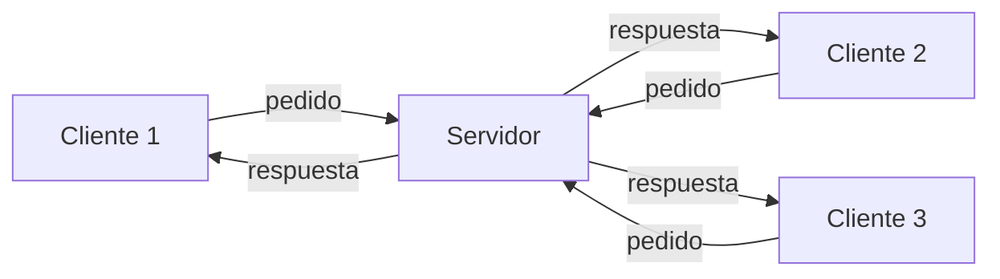
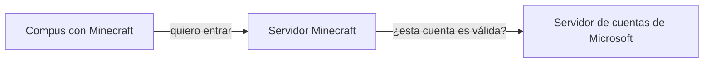

<!-- slide: tipo=portada -->
# Backend
HTTP, cliente-servidor y nuestro primer servidor con Express
Clase Backend — 2C 2026

---

# ¿Qué es el backend?

---

## Lo que el usuario no ve

- El **frontend** es la parte del sistema con la que interactúa el usuario: la interfaz (UI, UX, interactividad)
- Casi siempre es visual, pero no siempre: una herramienta de terminal también tiene su frontend
- El **backend** procesa los datos, aplica la **lógica de negocio** y arma una respuesta
- No solo responde pedidos: también hace tareas propias (ej. borrar archivos viejos una vez por día) {tag:info}
- Dato: se le dice **full stack** a quien programa las dos partes {tag:note}

---

<!-- slide: tipo=comparacion -->
## ¿Dónde corre cada uno?

### Frontend
- En el dispositivo del usuario
- Navegador, app de celular, programa de escritorio
- Su código se descarga en el dispositivo: cualquiera puede verlo con F12 y alterarlo, así que no podemos confiar en lo que envíe

### Backend
- En un servidor de la organización (propio o en la nube)
- Un programa que queda corriendo esperando pedidos
- Ahí viven los datos y las reglas de negocio (precios, permisos, stock): el usuario no puede verlas ni saltearlas

---

# Cliente-servidor

---

## Dos actores

- Un **actor** puede ser cualquier cosa: una persona, un programa, una computadora, una tele
- El **cliente** quiere algo y se lo **pide** al servidor
- El **servidor** recibe el pedido y le **responde** al cliente
- Normalmente **muchos clientes** se conectan a **un mismo servidor** {tag:info}

---

<!-- slide: tipo=diagrama -->
## El modelo



---

## Ya lo usamos

- **Docker**: levantamos un servidor de Minecraft y los amigos se conectaban con el juego (el cliente)
- **PokeAPI**: un servidor en algún lugar del mundo; el cliente era nuestro JS con `fetch` o el navegador
- De ahora en más, cuando digamos "cliente" hablamos de **este** cliente, no del de un negocio {tag:tip}

---

<!-- slide: tipo=diagrama -->
## Ser cliente o servidor depende del punto de vista



- Cuando un jugador se conecta, el servidor de Minecraft le pregunta a Microsoft si la cuenta es legítima
- Para los jugadores, el servidor de Minecraft es **servidor**
- Para el servidor de cuentas, el mismo programa es **cliente** {tag:info}

---

# HTTP

---

## Un protocolo[^1]

- **H**yper**T**ext **T**ransfer **P**rotocol: el mismo "hipertexto" de HTML
- Un **protocolo** es un conjunto de reglas para que dos actores se entiendan
- Esta clase tiene uno implícito: hablamos en **castellano**, en voz alta, de a uno por vez. Si empiezo a hablar en japonés, nadie me entiende {tag:tip}
- HTTP define cómo son los mensajes que viajan en las flechas del diagrama: de ida y de vuelta

[^1]: MDN — [Generalidades del protocolo HTTP](https://developer.mozilla.org/es/docs/Web/HTTP/Guides/Overview)


---

## Un poco de historia[^1]

- Nace junto con HTML en el **CERN** (1989–1991), de la mano de **Tim Berners-Lee**
- La idea: compartir documentos científicos por la red. Las primeras versiones eran **muy** simples
- **HTTP/1.1** (1997): texto plano, legible por humanos. Es el que vamos a mirar

[^1]: MDN — [Evolución del protocolo HTTP](https://developer.mozilla.org/es/docs/Web/HTTP/Guides/Evolution_of_HTTP)


---

## Request y response

- Hay dos tipos de mensaje: el pedido (**request**) y la respuesta (**response**)
- Relación **uno a uno**: toda request tiene su response, aunque sea un error
- Sin request **no hay** response: el servidor no le habla al cliente por iniciativa propia {tag:warning}


---

## Anatomía de una request[^1]

```http
GET / HTTP/1.1
Host: developer.mozilla.org
Accept-Language: fr

```

- **Primera línea**: método, path y versión del protocolo
- **Headers**: metadata, uno por línea (`Nombre: valor`)
- Una línea vacía y después, opcionalmente, el **body** (el contenido) {tag:info}

[^1]: MDN — [Mensajes HTTP](https://developer.mozilla.org/es/docs/Web/HTTP/Guides/Messages)


---

## Los métodos: qué queremos hacer[^1]

- **GET** → obtener un recurso. Es el más común: el navegador lo usa cada vez que entramos a una página
- **POST** → crear un recurso nuevo, con los datos en el body
- **PUT** → reemplazar un recurso **completo** por el que mandamos
- **PATCH** → modificar **solo algunos campos** de un recurso
- **DELETE** → eliminar un recurso

[^1]: MDN — [Métodos de petición HTTP](https://developer.mozilla.org/es/docs/Web/HTTP/Reference/Methods)


---

## El path[^1]

- Qué **recurso** queremos: una página, un archivo, un producto
- Jerárquico, como el filesystem de Linux: `/` es la raíz
- `/productos` → `/productos/ropa` → `/productos/ropa/campera-animal-print`
- La estructura la diseña quien arma el servidor; hay convenciones que vamos a ver con REST {tag:note}

[^1]: MDN — [¿Qué es una URL?](https://developer.mozilla.org/es/docs/Learn_web_development/Howto/Web_mechanics/What_is_a_URL)


---

## Los headers[^1]

- Como la metadata de un archivo (autor, fecha, dueño): información **sobre** el mensaje, no el contenido
- `Accept-Language: fr` → "si tenés la página en francés, prefiero esa"
- El servidor puede **usarlos o ignorarlos**: depende 100% de él
- Hay headers estándar, pero también podemos inventar los nuestros {tag:tip}

[^1]: MDN — [Cabeceras HTTP](https://developer.mozilla.org/es/docs/Web/HTTP/Reference/Headers)


---

## Ejemplo: la tienda de Ricky Fort

```http
GET /productos/campera-animal-print HTTP/1.1
Host: rickyfortmerch.com.ar
```

```http
POST /productos/campera-animal-print/resenas HTTP/1.1
Host: rickyfortmerch.com.ar
Content-Type: application/json

{ "estrellas": 5, "texto": "Me queda pintada" }
```

- El GET trae la campera con sus reseñas; el POST agrega una reseña nueva, que viaja en el **body** {tag:tip}


---

## Anatomía de una response[^1]

```http
HTTP/1.1 200 OK
Content-Type: text/html; charset=utf-8
Date: Thu, 29 Oct 2026 19:00:00 GMT

<!doctype html>
<html>...
```

- **Primera línea**: versión, **status code** y **status message**
- Después, igual que la request: headers, línea vacía y body

[^1]: MDN — [Mensajes HTTP](https://developer.mozilla.org/es/docs/Web/HTTP/Guides/Messages)


---

## Status codes por familia[^1]

- **1xx** informativos: respuestas provisionales
- **2xx** éxito: la request se procesó correctamente
- **3xx** redirección: el recurso está en otra ubicación
- **4xx** error del **cliente**: la request es inválida o no puede atenderse
- **5xx** error del **servidor**: la request era válida, pero el servidor falló al procesarla {tag:warning}

[^1]: MDN — [Códigos de estado](https://developer.mozilla.org/es/docs/Web/HTTP/Reference/Status)


---

## Los más frecuentes

- **200 OK**: la request se completó con éxito. Es el código más común
- **201 Created**: se creó un recurso nuevo (la reseña de la campera) {tag:tip}
- **301 / 302**: el recurso se movió; el header `Location` indica la nueva ubicación
- **404 Not Found**: el recurso solicitado no existe
- **500 Internal Server Error**: error genérico del servidor (ej. no pudo acceder a la base de datos)


---

# HTTP en vivo

---

## ¿Quién arma estos mensajes?

- Depende de qué tan abstraídos estemos, como alto y bajo nivel en programación
- En el **navegador**, los arma el navegador
- En nuestro código, una **biblioteca** (`fetch`)
- En la terminal, **curl**
- O **nosotros, a mano** {tag:info}

---

## DevTools: pestaña Network

- **F12** → **Network** → recargar la página: cada fila es una request
- Columnas clave: **Status**, **Method**, **Type**, **Size** y **Time**
- Filtros: **Doc** para el HTML y **Fetch/XHR** para las llamadas a APIs
- Click en una fila: **Headers** (request y response), **Preview/Response** (el body) y **Timing**
- **Preserve log** conserva el historial al cambiar de página; **Disable cache** obliga a pedir todo de nuevo
- Click derecho → **Copy as cURL**: la misma request, lista para pegar en la terminal {tag:tip}

---

## Una página son muchas requests

- El navegador pide el HTML con un **GET**
- A medida que lo lee, encuentra `<link>`, `<script>` e ``
- Por cada uno arma **otra request**
- Si ya lo tenía guardado, usa la **caché** y no lo vuelve a pedir {tag:info}

---

## curl: un cliente HTTP en la terminal

```bash
curl google.com           # solo el body
curl -v google.com        # verbose: request (>) y response (<)
curl -L -v google.com     # sigue el Location (L de Location)
```

- Con `-v`, las líneas `>` son lo que mandamos y las `<` lo que nos responden. Las `*` las ignoramos {tag:info}
- `google.com` responde **301** hacia `www.google.com`: curl no lo sigue salvo que le pidamos `-L`

---

## curl: método y headers

```bash
curl -X POST localhost:3000/test           # otro método
curl -H "User-Agent: Google Chrome" google.com   # header propio
```

- `-X` cambia el método (por defecto usa **GET**)
- `-H` agrega o pisa un header

---

## HTTP a mano

```bash
nc google.com 80
```

```http
GET / HTTP/1.1
Host: www.google.com
Accept: text/plain

```

- Abrimos una conexión con Google en el puerto **80** (el de HTTP) y escribimos el mensaje nosotros. Dos enters y responde
- Si nos salimos del protocolo: **400 Bad Request**
- Pedimos `text/plain` y nos mandó HTML igual: el header se puede ignorar {tag:note}

---

## ¿Para qué nos sirve todo esto?

- Para **debuggear**: ¿llegó la request? ¿con qué headers? ¿qué status volvió?
- Va a ser clave cuando armen una API o un front que hable con un servidor

---

# APIs REST

---

## ¿Qué es una API?

- **API** (*Application Programming Interface*): el contrato que define cómo un programa le pide cosas a otro
- En una **API web**, ese contrato son requests HTTP: qué paths existen, con qué métodos y qué devuelven
- El cliente suele ser otro programa (nuestro JS con `fetch`, una app de celular) y la respuesta son **datos**, generalmente en **JSON**, no una página
- Ejemplo: la web de la tienda de Ricky Fort pide `GET /productos` y con el JSON que recibe arma el catálogo {tag:info}

---

## ¿Qué es REST?

- **REST** (*Representational State Transfer*) es un **estilo de arquitectura** para diseñar APIs web
- No es un protocolo ni una biblioteca: es un conjunto de **convenciones** sobre cómo usar HTTP
- Lo propuso Roy Fielding en el año 2000, uno de los autores de la especificación de HTTP
- Una API que respeta estas convenciones se llama **RESTful** {tag:note}

---

## Qué propone REST: recursos y métodos

- **Recursos**: la API se organiza en torno a *cosas* (productos, usuarios, reseñas), nombradas con **sustantivos**
- **Cada recurso tiene su URL**: `/productos` es la colección y `/productos/campera-animal-print` es un elemento
- **La acción la indica el método**, no el path: GET obtiene, POST crea, PUT y PATCH modifican, DELETE elimina

---

## Qué propone REST: respuestas y estado

- **El status code dice qué pasó**: 201 si se creó, 404 si no existe, 400 si los datos son inválidos
- **Sin estado** (*stateless*): cada request trae todo lo necesario; el servidor no recuerda las anteriores
- El recurso viaja en una **representación**, casi siempre JSON (lo indica el header `Content-Type`) {tag:info}

---

## Colección y elemento

```http
GET    /productos                        → lista todos los productos
POST   /productos                        → crea un producto nuevo
GET    /productos/campera-animal-print   → obtiene ese producto
PUT    /productos/campera-animal-print   → lo reemplaza completo
PATCH  /productos/campera-animal-print   → modifica algunos campos
DELETE /productos/campera-animal-print   → lo elimina
```

- Con solo **dos paths** y los métodos cubrimos todo el **CRUD**: *Create*, *Read*, *Update*, *Delete* {tag:tip}

---

## Recursos relacionados y filtros

```http
GET  /productos/campera-animal-print/resenas  → sus reseñas
POST /productos/campera-animal-print/resenas  → publica una reseña
GET  /productos?categoria=ropa&orden=precio   → filtra y ordena
```

- Un recurso que pertenece a otro se **anida** en el path: la reseña es *de* un producto
- Los filtros, el orden y la paginación van en la **query string** (después del `?`), no en el path
- El POST de la reseña es el mismo que vimos en el ejemplo de la tienda {tag:note}

---

<!-- slide: tipo=comparacion -->
## Verbos en el path vs. métodos

### No es REST
- `GET /obtenerProductos`
- `POST /crearProducto`
- `POST /actualizarProducto?id=campera-animal-print`
- `GET /borrarProducto?id=campera-animal-print`

### Es REST
- `GET /productos`
- `POST /productos`
- `PATCH /productos/campera-animal-print`
- `DELETE /productos/campera-animal-print`

---

## Un GET no debe modificar nada

```http
GET /borrarProducto?id=campera-animal-print HTTP/1.1
Host: rickyfortmerch.com.ar
```

- GET es un método **seguro**: por definición solo lee
- Navegadores, buscadores y previsualizaciones de links hacen GET **sin que nadie lo pida**: si un GET borra, cualquiera de ellos puede borrar el catálogo {tag:danger}
- Para eliminar está **DELETE**: `DELETE /productos/campera-animal-print`

---

## El status code tiene que decir la verdad

```http
HTTP/1.1 200 OK
Content-Type: application/json

{"error": "El producto no existe"}
```

- El body dice que hubo un error, pero el status dice que salió todo bien
- `fetch`, las DevTools y cualquier cliente miran **primero el status**: van a tratarlo como un éxito
- Lo correcto es responder **404 Not Found**, con ese mismo body si queremos dar más detalle {tag:warning}

---

## Todo por POST a un solo endpoint

```http
POST /api HTTP/1.1
Host: rickyfortmerch.com.ar
Content-Type: application/json

{"accion": "eliminar", "producto": "campera-animal-print"}
```

- **Esto no es REST**: la acción viaja escondida en el body y el path es siempre el mismo
- Desde afuera no se puede saber qué hace cada request: las DevTools, los logs y la caché dejan de ser útiles {tag:danger}
- Lo correcto es que el método y el path digan la acción: `DELETE /productos/campera-animal-print`

---

## ¿Cuáles son REST?

1. `GET /productos/campera-animal-print`
2. `GET /productos/eliminar/campera-animal-print`
3. `POST /productos/campera-animal-print/resenas`
4. `POST /getResenas`
5. `DELETE /productos/campera-animal-print/resenas/7`
6. `PUT /productos/campera-animal-print` que responde `200 OK` con `{"error": "datos inválidos"}`

---

## Respuestas

1. **Sí**: obtiene un elemento de la colección
2. **No**: el verbo está en el path y un GET no debe borrar. Lo correcto: `DELETE /productos/campera-animal-print`
3. **Sí**: crea una reseña dentro del producto
4. **No**: lectura con POST y verbo en el path. Lo correcto: `GET /productos/campera-animal-print/resenas`
5. **Sí**: elimina la reseña 7 de ese producto
6. **No**: el path y el método están bien, pero el status miente. Lo correcto: **400 Bad Request**

---

## REST es una convención

- Nada obliga a seguirla: Express (y HTTP) aceptan cualquier path con cualquier método
- Pero vuelve a la API **predecible**: si conozco `/productos`, puedo adivinar cómo funciona `/usuarios`
- Quien la consume aprovecha lo que ya sabe de HTTP: métodos, status codes y headers
- Es la convención que vamos a seguir al armar nuestra propia API con Express {tag:tip}

---

# Nuestro propio servidor

---

## ¿Con qué lenguaje?

- Un servidor HTTP se puede escribir en casi cualquier lenguaje: Python, C, Rust, Java, Elixir...
- Usamos **JavaScript**, que ya conocemos del front: un lenguaje menos que aprender
- [**Node.js**](https://nodejs.org) es un *runtime*: ejecuta JS fuera del navegador
- [**Express**](https://expressjs.com) es un framework web para Node: minimalista y no opinionado {tag:info}

---

## Arrancar un proyecto

```bash
mkdir api && cd api
npm init -y               # como git init, pero para Node
npm install express       # agrega una dependencia
```

- `npm` es el administrador de paquetes de Node (las bibliotecas de JS se llaman **paquetes**)
- `npm init` crea el `package.json`, que marca la **raíz** del proyecto

---

## Qué aparece en la carpeta

- `package.json`: nombre, versión, `main` y **dependencies** (`express`)
- `node_modules/`: el código de las dependencias
- `package-lock.json`: las versiones **exactas** que se instalaron
- Quien clone el repo corre `npm install` y obtiene lo mismo {tag:tip}
- `node_modules/` va al **`.gitignore`**: pesa mucho y se regenera {tag:warning}

---

## Hola mundo

```js
const express = require("express");
const app = express();
const port = 3000;

app.get("/", (req, res) => {
  res.send("Hello World!\n");
});

app.listen(port, () => {
  console.log(`Escuchando en el puerto ${port}`);
});
```

---

## Línea por línea

- `express()` crea la aplicación
- `app.get("/", handler)` **declara** una ruta: GET a la raíz. No ejecuta nada en el momento
- El **handler** recibe `req` (los datos de la request) y `res` (donde armamos la response)
- `app.listen` abre el puerto y llama a la función cuando ya está escuchando
- El programa **no termina**: se queda esperando requests. Se corta con **Ctrl+C** {tag:info}

---

## ¿Qué es el puerto?

- Una máquina puede tener muchos servidores a la vez: el **puerto** identifica a cuál le hablamos
- **80** es el puerto por defecto de HTTP (el que usamos con `nc`) y **443** el de **HTTPS** (HTTP + encriptación)
- Por eso `google.com` no lleva puerto, pero `localhost:3000` sí
- Los puertos bajos son "privilegiados": para desarrollar usamos **3000**, **8000**, etc. {tag:tip}
- Si el puerto ya está ocupado, el servidor no arranca (`EADDRINUSE`) {tag:warning}

---

## Correrlo y probarlo

```bash
node index.js
curl -v localhost:3000
```

- También desde el navegador: `http://localhost:3000`

---

## Reiniciar en cada cambio

- Node lee el archivo **una vez** al arrancar: si cambiamos el código, hay que reiniciar
- Para no hacerlo a mano: **nodemon**, que reinicia solo cuando detecta cambios

```bash
npm install --save-dev nodemon   # solo para desarrollo
npx nodemon index.js
```

- `--save-dev` lo guarda en `devDependencies`: no hace falta para correr en producción
- `npx` ejecuta un programa que viene dentro de un paquete

---

## Agregar rutas

```js
app.get("/test", (req, res) => {
  res.send("test\n");
});

app.post("/test", (req, res) => {
  res.send("test creado\n");
});
```

```bash
curl localhost:3000/test
curl -X POST localhost:3000/test
```

- Mismo path y distinto método: son dos **endpoints** distintos {tag:info}

---

## Controlar la response

```js
app.post("/test", (req, res) => {
  res.status(201).set("Hola", "mundo").send("test creado\n");
});
```

- `res.status()` cambia el status code: un POST que crea debería dar **201**
- `res.set()` agrega un header propio
- Con `curl -v` vemos el `201 Created` y el header `Hola: mundo` {tag:tip}

---

<!-- slide: tipo=bibliografia -->
## Bibliografía

1. MDN — Generalidades del protocolo HTTP (https://developer.mozilla.org/es/docs/Web/HTTP/Guides/Overview)
2. MDN — Métodos de petición HTTP (https://developer.mozilla.org/es/docs/Web/HTTP/Reference/Methods)
3. MDN — Códigos de estado de respuesta HTTP (https://developer.mozilla.org/es/docs/Web/HTTP/Reference/Status)
4. MDN — REST (https://developer.mozilla.org/es/docs/Glossary/REST)
5. Express — Getting started (https://expressjs.com/en/starter/installing.html)
6. Express — Basic routing (https://expressjs.com/en/starter/basic-routing.html)
7. Node.js — Download (https://nodejs.org/en/download)
8. curl — Manual (https://curl.se/docs/manual.html)

---

<!-- slide: tipo=cierre -->
# ¡Gracias!

Próxima clase: armamos nuestra propia API
