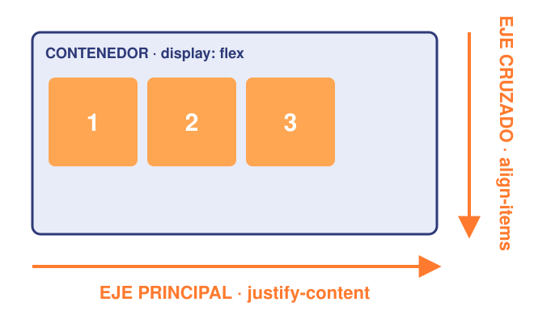
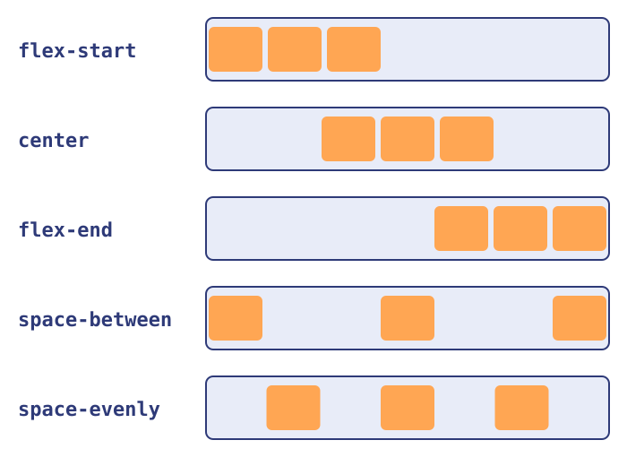
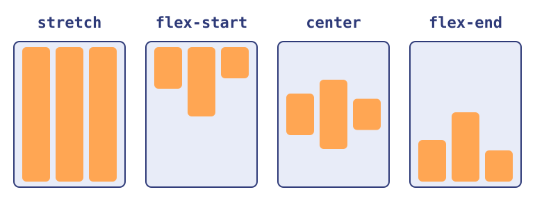
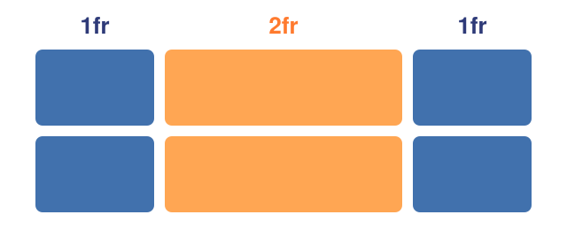
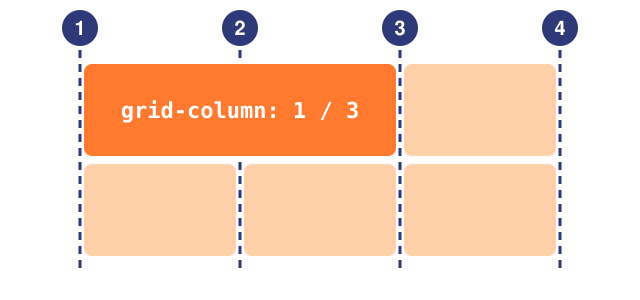
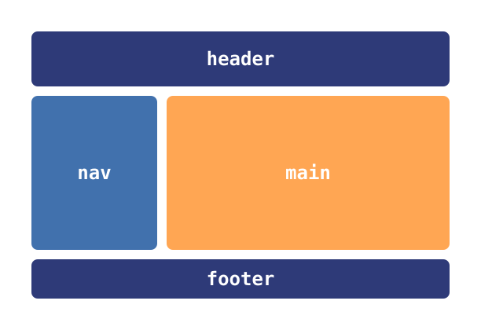

<!-- slide: tipo=portada -->
# CSS: layout, variables y funciones
Flexbox, Grid y cómo dejar de repetirnos
Clase Flexbox, Grid y variables — 2026

---

# El problema del layout

---

## ¿Cómo ponemos cosas una al lado de la otra?

- Por defecto las cajas se **apilan** una abajo de la otra
- Antes se resolvía con tablas, `float` y `position`: hacks difíciles de mantener {tag:warning}
- Hoy CSS trae dos sistemas pensados para esto: **Flexbox** y **Grid**
- Los dos se activan con `display`: `display: flex;` o `display: grid;`

---

## Contenedor e ítems

```html
<div class="contenedor">        <!-- padre: acá va el display -->
  <div>Uno</div>                <!-- ítem -->
  <div>Dos <span>!</span></div> <!-- ítem; el span NO es ítem -->
</div>
```

- El layout se define en el **padre**: el **contenedor**
- Sus **hijos directos** son los **ítems** que se acomodan
- Los nietos no: siguen con su `display` de siempre {tag:info}

---

# Flexbox

---

## display: flex

```css
.menu {
  display: flex;
}
```

- Aplicado a un `<nav class="menu">` con tres `<a>` adentro
- Los hijos pasan a ponerse **en fila**, uno al lado del otro
- Cada ítem mide lo que mide su contenido

---

<!-- slide: tipo=imagen-texto -->
## Los dos ejes



- **Eje principal:** la dirección en la que se acomodan los ítems
- **Eje cruzado:** el perpendicular
- `justify-content` alinea sobre el **principal**
- `align-items` alinea sobre el **cruzado**

---

## flex-direction

```css
.contenedor {
  display: flex;
  flex-direction: column; /* row | row-reverse | column | column-reverse */
}
```

- `row`: en fila (**por defecto**) · `column`: en columna
- Con `column` **se rotan los ejes**: el principal pasa a ser el vertical {tag:warning}

---

<!-- slide: tipo=imagen-texto -->
## justify-content: el eje principal



- `flex-start`: todos al principio (**por defecto**)
- `center`: todos al medio
- `flex-end`: todos al final
- `space-between`: el espacio libre va **entre** los ítems
- `space-evenly`: el mismo espacio entre ítems y en los bordes

---

<!-- slide: tipo=imagen-texto -->
## align-items: el eje cruzado



- `stretch`: se estiran al alto del contenedor (**por defecto**)
- `flex-start` / `center` / `flex-end`: arriba, al medio, abajo
- Centrar en los dos ejes: `justify-content: center` + `align-items: center` {tag:tip}

---

## Centrar un div (el meme)

```css
.contenedor {
  display: flex;
  justify-content: center;
  align-items: center;
  height: 100vh;
}
```

- Tres líneas y listo · `100vh`: todo el alto de la ventana (*viewport height*)

---

## gap y flex-wrap

```css
.galeria {
  display: flex;
  flex-wrap: wrap; /* si no entran, bajan a otra línea */
  gap: 16px;       /* espacio entre ítems */
}
```

- `gap`: separa los ítems sin tener que andar poniendo `margin`
- Sin `wrap`, flex mete todo en **una sola línea** y achica los ítems

---

## Propiedades de los ítems

```css
.buscador  { flex-grow: 1; }       /* ocupa todo el espacio que sobra */
.logo      { flex-shrink: 0; }     /* nunca se achica */
.destacado { align-self: center; } /* su propio align-items */
```

- `flex-grow`: cuánto **crece** para llenar el espacio libre
- `flex-shrink`: cuánto se **achica** si falta espacio
- Estas van en el **hijo**, no en el contenedor {tag:warning}

---

## Ejemplo: una barra de navegación

```css
.navbar {
  display: flex;
  justify-content: space-between; /* logo | links */
  align-items: center;
}
.navbar .links { display: flex; gap: 24px; }
```

- Flex dentro de flex: un ítem también puede ser contenedor {tag:tip}

---

# Grid

---

## display: grid

```css
.grilla {
  display: grid;
  grid-template-columns: 200px 200px 200px;
}
```

- Definimos las **columnas** (y si queremos, las filas) en el contenedor
- Los hijos ocupan las celdas en orden; cuando se llenan, se arma una **fila nueva** sola

---

<!-- slide: tipo=imagen-texto -->
## La unidad fr



- `fr` es una **fracción** del espacio disponible
- `1fr 2fr 1fr`: la del medio mide el doble que las otras
- Se mezcla con medidas fijas: `250px 1fr` = barra lateral fija y el resto para el contenido {tag:tip}

---

## repeat()

```css
.galeria {
  display: grid;
  grid-template-columns: repeat(3, 1fr);
}
```

- `repeat(3, 1fr)` es lo mismo que `1fr 1fr 1fr`
- Evita repetir a mano cuando son muchas columnas iguales

---

## Una grilla responsive con minmax()

```css
.responsive {
  display: grid;
  grid-template-columns: repeat(auto-fit, minmax(200px, 1fr));
}
```

- `minmax(200px, 1fr)`: cada columna mide **por lo menos** 200px
- `auto-fit`: entran tantas columnas como quepan, responsive sin más código {tag:tip}

---

<!-- slide: tipo=imagen-texto -->
## Ubicar ítems con las líneas



- Las líneas de la grilla se numeran **desde 1**
- `grid-column: 1 / 3`: de la línea 1 a la 3, ocupa dos columnas
- `grid-column: span 2`: ocupa dos columnas desde donde le toque
- Lo mismo para filas con `grid-row`

---

## grid-template-areas

```css
.pagina {
  display: grid;
  grid-template-columns: 200px 1fr;
  grid-template-areas:
    "header header"
    "nav    main"
    "footer footer";
}
```

---

<!-- slide: tipo=imagen-texto -->
## Las áreas, dibujadas



- Le ponemos **nombre** a cada zona y "dibujamos" el layout con texto
- Cada string es una **fila**; repetir un nombre estira la zona
- Ideal para el esqueleto de la página con los **tags semánticos** {tag:tip}

---

## Cada hijo, a su área

```css
header { grid-area: header; }
nav    { grid-area: nav; }
main   { grid-area: main; }
footer { grid-area: footer; }
```

- Cada hijo dice en qué zona va con `grid-area`
- El nombre va **sin comillas** acá: las comillas son solo para el dibujo

---

<!-- slide: tipo=comparacion -->
## Flexbox vs. Grid

### Flexbox
- **Una dimensión:** fila **o** columna
- El **contenido** define el tamaño de cada ítem
- Ideal para componentes: navbars, botones, centrar cosas

### Grid
- **Dos dimensiones:** filas **y** columnas
- El **contenedor** define la estructura
- Ideal para el layout de la página, galerías, dashboards

---

## No compiten: se combinan

- **Grid** para el esqueleto de la página: header, nav, main, footer
- **Flex** adentro de cada parte: la navbar, una tarjeta, una fila de botones
- En DevTools, el chip `flex` o `grid` al lado del elemento dibuja los ejes y las líneas {tag:info}

---

# Variables y funciones

---

## Repetir valores es un problema

```css
.boton  { background-color: #ff5a1f; }
.titulo { color: #ff5a1f; }
.alerta { border: 2px solid #ff5a1f; }
```

- Si cambia el color de la marca, hay que buscarlo y cambiarlo **en todos lados**
- Es fácil que quede un `#ff5b1f` perdido por ahí {tag:warning}

---

## Variables CSS (custom properties)

```css
:root { --color-principal: #ff5a1f; }
.boton {
  background-color: var(--color-principal);
}
```

- Se declaran con **dos guiones** adelante: `--nombre: valor;`
- Se usan con `var(--nombre)`
- `:root` es el `<html>`: lo que se declara ahí está disponible en **toda** la página

---

## Las variables respetan la cascada

```css
.tarjeta { --color-principal: #1f7a46; } /* la pisa solo acá */
.boton {
  color: var(--color-acento, black); /* si no existe: black */
}
```

- Las variables se **heredan**: todo lo que está dentro de `.tarjeta` ve el verde
- El segundo argumento de `var()` es un **valor por defecto**

---

## Ejemplo: modo oscuro

```css
:root   { --fondo: white;   --texto: #222222; }
.oscuro { --fondo: #121212; --texto: #eeeeee; }
body    { background-color: var(--fondo); color: var(--texto); }
```

- Con `<body class="oscuro">` cambia **toda** la página sin tocar ninguna otra regla
- La web de la materia (Docusaurus) lo hace así: `--ifm-color-primary` {tag:info}

---

## Funciones en CSS

- Una función recibe **argumentos** y devuelve un **valor**: `nombre(argumentos)`
- Se usan como valor de una propiedad
- Algunas ya aparecieron hoy: `var()`, `repeat()`, `minmax()`

---

## calc()

```css
.contenido {
  width: calc(100% - 250px);          /* todo menos la barra lateral */
  padding: calc(var(--espacio) * 2);
}
```

- Hace cuentas **mezclando unidades**: `%` con `px`, `rem` con `vw`...
- Se combina con variables
- Los espacios alrededor de `+` y `-` son **obligatorios** {tag:warning}

---

## min(), max() y clamp()

```css
.contenedor { width: min(90%, 1200px); }
.titulo     { font-size: clamp(1.5rem, 4vw, 3rem); }
```

- `min()` / `max()`: el más chico / el más grande; acá **nunca pasa** de 1200px
- `clamp(mín, ideal, máx)`: usa el ideal, pero sin salirse de los extremos
- Texto que se adapta al ancho de la pantalla (`4vw` = 4% del ancho) {tag:tip}

---

## Funciones de color

```css
:root {
  --naranja: rgb(255 90 31);
  --naranja-suave: rgb(255 90 31 / 0.2);  /* 20% de opacidad */
  --naranja-oscuro: color-mix(in srgb, var(--naranja), black 20%);
}
```

- `rgb()` y `hsl()` arman un color; después de la `/` va la **opacidad**
- `color-mix()` mezcla dos colores: toda la paleta sale de **una sola** variable

---

## Resumen de funciones

- `var()`: leer una variable
- `calc()`: hacer cuentas
- `min()` / `max()` / `clamp()`: acotar valores
- `repeat()` / `minmax()`: armar las columnas de una grilla
- `rgb()` / `hsl()` / `color-mix()`: colores

---

# Práctica

---

## A laburar…

- Armar desde cero una **página de perfil**: foto, nombre, links y una galería de proyectos
- El esqueleto con `grid-template-areas`: header, nav, main y footer
- La navbar con flexbox y la galería con `repeat(auto-fit, minmax(...))`
- Todos los colores y espacios en variables dentro de `:root` {tag:tip}

---

## Para practicar jugando

- **Flexbox Froggy** — flexboxfroggy.com
- **Grid Garden** — cssgridgarden.com
- **Flexbox Defense** — flexboxdefense.com

---

<!-- slide: tipo=bibliografia -->
## Referencias

1. MDN — Conceptos básicos de Flexbox (developer.mozilla.org/es/docs/Web/CSS/CSS_flexible_box_layout/Basic_concepts_of_flexbox)
2. MDN — Conceptos básicos de Grid Layout (developer.mozilla.org/es/docs/Web/CSS/CSS_grid_layout/Basic_concepts_of_grid_layout)
3. MDN — Propiedades personalizadas (variables) (developer.mozilla.org/es/docs/Web/CSS/Using_CSS_custom_properties)
4. CSS-Tricks — A Complete Guide to Flexbox (css-tricks.com/snippets/css/a-guide-to-flexbox)
5. CSS-Tricks — A Complete Guide to CSS Grid (css-tricks.com/snippets/css/complete-guide-grid)

---

<!-- slide: tipo=cierre -->
## Gracias
