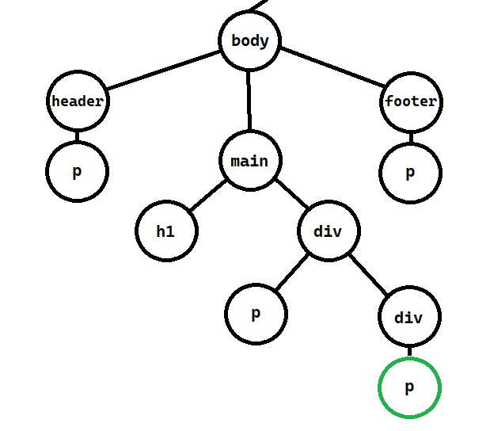
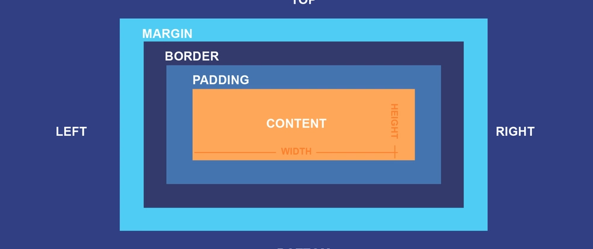

<!-- slide: tipo=portada -->
# HTML & CSS
Dándole forma a la web
Clase HTML y CSS — 2026

---

# Un poco de historia

---

<!-- slide: tipo=imagen-texto -->
## HTML: el origen


- **Tim Berners-Lee**, CERN, **1989**
- Hipertexto para compartir artículos científicos
- Conectar información **descentralizada**: nace la Web
- 18 tags al principio (hoy ~140); primera página en **1991**

---

<!-- slide: tipo=imagen-texto -->
## CSS: el diseño


- **Håkon Wium Lie** y **Bert Bos**, **1994**
- Ordenar el caos visual de la web primitiva
- Un **estándar** para darle estilo a las páginas
- **Separar estructura (HTML) de apariencia (CSS)**

---

# HTML

---

## ¿Qué es HTML?

- Es el **esqueleto** de una página web
- **H**yper**T**ext **M**arkup **L**anguage (lenguaje de marcado de hipertexto)
- Un lenguaje de marcado para estructurar y presentar contenido en un navegador
- Está basado en **etiquetas (tags)** que el navegador interpreta y les da sentido

---

## ¿Para qué sirve HTML?

- Organizar los elementos de nuestra web
- Darle formato a nuestro contenido
- Crear formularios
- Mostrar contenido multimedia
- Hacer accesible nuestra web

---

## ¿Qué es un tag?

```html
<p>Hola FIUBA</p>
```

- Marcadores que **envuelven** contenido para definir su tipo y propósito
- Tienen **apertura** `<p>`, **contenido** y **cierre** `</p>`
- Algunos no tienen cierre: ``, `<br>`, `<hr>`

---

## Atributos

```html
<a href="https://www.uba.ar">UBA</a>
```

- Información extra que va **dentro del tag de apertura**: `atributo="valor"`
- `href`: el link al que apunta un `<a>`
- `src`: la ruta de la imagen de un ``
- `id`: identificador del tag, **debe ser único**
- `style`: estilos que le agregamos al tag

---

## Imágenes y el atributo alt

```html

```

- `alt` describe la imagen para quien **no la ve**: los lectores de pantalla lo leen en voz alta
- También se muestra si la imagen **no carga**
- Si la imagen es solo decorativa, va vacío: `alt=""`
- Toda `` lleva `alt` {tag:tip}

---

## Estructura básica de un archivo HTML

```html
<!DOCTYPE html>
<html>
  <head>
    <title>Mi primera página</title>
  </head>
  <body>
    <h1>Hola FIUBA</h1>
    <p>Esto es un párrafo.</p>
  </body>
</html>
```

---

## Estructura básica: qué es cada parte

- `<!DOCTYPE html>`: declaración del tipo de documento
- `<html>`: raíz del documento
- `<head>`: metadatos (por ejemplo, el título de la pestaña)
- `<body>`: el contenido visible de la página
- `<footer>`: pie de página (opcional)

---

## Tags básicos — parte 1

- `<h1>`: título
- `<h2>`: título, pero más chico
- `<h3>`: título, pero más más chico
- `<p>`: párrafo
- `<a>`: link
- ``: imagen

---

## Tags básicos — parte 2

- `<ul>`: lista no ordenada · `<ol>`: lista ordenada · `<li>`: elemento de lista
- `<strong>` o `<b>`: negrita
- `<em>` o `<i>`: cursiva
- `<u>`: subrayado
- `<br>`: salto de línea
- `<hr>`: línea horizontal

---

## Tags básicos — parte 3

- `<div>`: una división o sección del documento
- `<span>`: un fragmento inline, para darle estilo a una parte de un texto
- `<table>`: una tabla
- `<tr>`: una fila de la tabla
- `<td>`: una celda de la tabla

---

## Formularios

```html
<form>
  <label for="nombre">Nombre</label>
  <input type="text" id="nombre" name="nombre">
  <button type="submit">Enviar</button>
</form>
```

---

## Formularios: qué es cada parte

- `<form>`: agrupa los campos que se envían juntos
- `<input>`: un campo; el `type` dice cuál (`text`, `email`, `password`, `checkbox`...)
- `<label>`: el texto del campo; su `for` apunta al `id` del input
- `<button>`: el botón que envía el formulario

---

## Tags semánticos

- `<header>`: el encabezado (logo, título, menú)
- `<nav>`: la navegación
- `<main>`: el contenido principal, uno solo por página
- `<section>` / `<article>`: una sección / un contenido que se sostiene solo (ej: una noticia)
- `<footer>`: el pie de página
- Se ven igual que un `<div>`, pero le dicen al navegador, a Google y a los lectores de pantalla **qué es** cada parte {tag:tip}

---

## Identificadores y clases

```html
<h1 id="titulo-principal">Intro Camejo</h1>
<p class="destacado">HTML</p>
<p class="destacado">CSS</p>
```

- Ambos son **atributos** de nuestros tags
- `id` identifica **unívocamente** a un tag dentro del documento
- `class` **agrupa** tags que son similares

---

<!-- slide: tipo=imagen-texto -->
## Jerarquía: el árbol DOM



- Los tags se **anidan** como contenedores, uno dentro de otro
- **Padre:** el contenedor
- **Hijo:** el elemento anidado
- El navegador arma con eso un **árbol**: el DOM

---

## A laburar…

- Crear un archivo HTML que diga **"Graphic design is my passion"**
- Agregarle la lista del súper
- ¡Cuidado con los tags! Que no sobren ni falten aperturas o cierres {tag:warning}

---

# CSS

---

## ¿Qué es CSS?

- Define la **presentación** de un documento HTML
- **C**ascading **S**tyle **S**heets (hojas de estilo en cascada)
- Separa la estructura (HTML) del estilo (CSS)

---

## ¿Para qué sirve CSS?

- Personalizar la apariencia de una página web
- Hacer las páginas más atractivas y fáciles de usar
- Crear diseños **responsivos** que se adapten a distintos dispositivos
- Mejorar la accesibilidad

---

## Anatomía de una regla CSS

```css
p {
  color: blue;
  font-size: 16px;
}
```

- **Selector** (`p`): el elemento HTML que queremos afectar
- **Propiedad** (`color`): el aspecto visual que vamos a modificar
- **Valor** (`blue`): el dato concreto del cambio

---

## Selectores

```css
p            { color: red; }       /* por tipo de elemento */
#mi-elemento { color: green; }     /* por id */
.mi-clase    { color: blue; }      /* por clase */
```

- Por **tipo**: `p`, `h1`, `div`
- Por **id**: `#mi-elemento`
- Por **clase**: `.mi-clase`

---

## La cascada: ¿de qué color queda?

```css
p          { color: green; }
.destacado { color: blue; }
#intro     { color: red; }    /* gana esta */
```

- Las tres reglas apuntan al mismo `<p id="intro" class="destacado">`
- Queda **rojo**: la regla por `id` es la más específica

---

## Las reglas de la cascada

- **Especificidad:** si dos reglas chocan, gana la más específica: `#id` > `.clase` > `tag`
- **Orden:** a igual especificidad, gana la **última** que aparece
- **Herencia:** algunas propiedades pasan de padre a hijo (`color`, `font-family`), otras no (`margin`, `border`)
- Si un estilo "no te toma", casi siempre es la cascada {tag:info}

---

## Propiedades y valores

- **Propiedades:** `color`, `font-size`, `background-color`, `margin`, `padding`, etc.
- **Colores:** por nombre (`red`), hexadecimal (`#ff6600`), RGB (`rgb(255, 102, 0)`)
- **Unidades de medida:** `px`, `em`, `rem`

---

## Cómo incorporar CSS a HTML

- **Estilo en línea:** dentro del tag, con el atributo `style` {tag:danger}
- **Hoja de estilos interna:** dentro de un `<style>` en el `<head>` {tag:warning}
- **Hoja de estilos externa:** un archivo `.css` vinculado al HTML {tag:tip}

---

## Hoja de estilos externa

```html
<head>
  <link rel="stylesheet" href="estilos.css">
</head>
```

- El `.css` vive en su propio archivo y se vincula desde el `<head>`
- Un mismo archivo de estilos sirve para **todas** las páginas del sitio

---

<!-- slide: tipo=comparacion -->
## Block vs. inline

### Block
- Ocupa **todo el ancho** disponible
- Arranca en una **línea nueva**
- Respeta `width`, `height`, `margin` y `padding`
- Ej: `<div>`, `<p>`, `<h1>`, `<ul>`

### Inline
- Ocupa **solo lo que mide** su contenido
- Se acomoda **en la misma línea** que el texto
- Ignora `width` y `height`
- Ej: `<span>`, `<a>`, `<strong>`, `<em>`

---

<!-- slide: tipo=imagen-texto -->
## El modelo de caja (box model)



- Todo elemento HTML es una **caja** rectangular
- **Content:** el contenido real
- **Padding:** espacio interior
- **Border:** el borde
- **Margin:** espacio exterior

---

# Práctica

---

## Herramientas de desarrollo (DevTools)

- Se abren con **F12**, o clic derecho → **Inspeccionar**
- **Elements:** el árbol DOM de la página, en vivo
- **Styles:** las reglas CSS de cada elemento; las tachadas son las que **perdieron en la cascada**
- **Computed:** el box model del elemento con sus medidas reales
- Lo que cambiás ahí es **temporal**: se pierde al recargar {tag:info}

---

## ¿Dudas? Muchas. Vamos a hacer unos ejercicios

- Entrar a **promiedos.com.ar** e **inspeccionar** (F12)
- Jugar con los estilos de la página desde el inspector
- Darle estilo a nuestra página de "Graphic design is my passion"

---

<!-- slide: tipo=bibliografia -->
## Referencias (cuasi biblias)

1. MDN — Conceptos básicos de HTML (developer.mozilla.org/es/docs/Learn/Getting_started_with_the_web/HTML_basics)
2. MDN — Conceptos básicos de CSS (developer.mozilla.org/es/docs/Learn/Getting_started_with_the_web/CSS_basics)
3. W3Schools — HTML Tutorial (w3schools.com/html)
4. W3Schools — CSS Tutorial (w3schools.com/css)

---

<!-- slide: tipo=cierre -->
## Gracias
