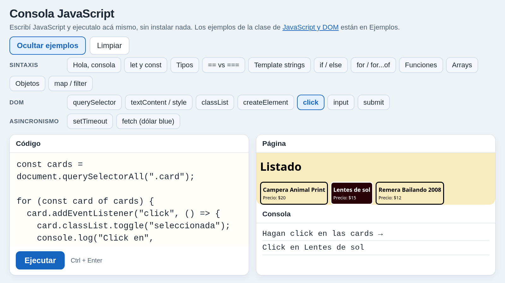
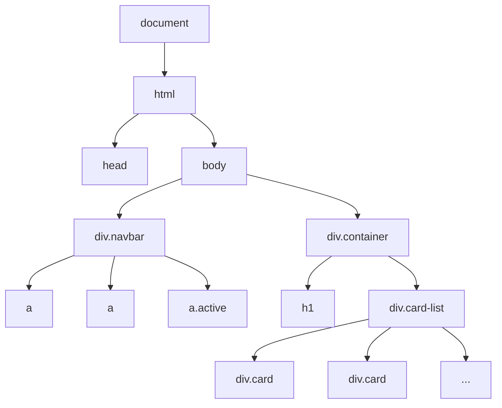

<!-- slide: tipo=portada -->
# JavaScript y el DOM
Del HTML estático a páginas que reaccionan
Clase JavaScript — 2026

---

# ¿Qué es JavaScript?

---

## El tercer lenguaje de la web

- **HTML** dice qué hay en la página, **CSS** dice cómo se ve y **JavaScript** dice qué **hace**
- Es un lenguaje de programación de verdad: variables, condiciones, ciclos, funciones
- Nació en 1995 en Netscape (en 10 días 😅). Hoy el estándar se llama **ECMAScript** {tag:info}
- No tiene nada que ver con Java: el nombre fue marketing {tag:note}

---

## ¿Dónde corre?

- En el **navegador**: cada pestaña tiene su motor (V8 en Chrome, SpiderMonkey en Firefox)
- En el **servidor** o la terminal, con **Node.js**: el mismo lenguaje sin página
- Hoy nos quedamos en el navegador: JS que **lee y modifica la página** {tag:tip}

---

## Cargar un script: `<script>`

```html
<head>
  <link rel="stylesheet" href="style.css">
  <script src="app.js" defer></script>
</head>
```

- `src` apunta a un archivo `.js` aparte, igual que el CSS con `<link>`
- `defer`: el script se ejecuta **cuando el HTML ya terminó de cargarse**
- Sin `defer` (en el `<head>`), el script corre antes de que existan los elementos y `querySelector` devuelve `null` {tag:warning}

---

## La consola y las DevTools

- **F12** (o click derecho → Inspeccionar) → pestaña **Console**
- Ahí aparecen los `console.log` y los **errores** (en rojo, con archivo y línea)
- También se puede escribir JS directo y probarlo sobre la página abierta {tag:tip}
- La pestaña **Elements** muestra el DOM **en vivo**: lo que cambie JS se ve ahí

---

<!-- slide: tipo=imagen-texto -->
## Consola JavaScript de la materia



- Todos los ejemplos de hoy están en https://www.intro-camejo.com.ar/js-consola/
- **Cero instalación**: se abre en el navegador, se edita y se corre con Ctrl+Enter
- Los ejemplos de DOM traen una mini página para tocar
- Cada slide tiene el link a su ejemplo {tag:tip}

---

# Sintaxis en 20 minutos

---

## Variables: `let` y `const`

```js
const nombre = "Ricky";   // no se puede reasignar
let visitas = 0;          // sí se puede
visitas = visitas + 1;
nombre = "Fort";          // TypeError
```

- Usen `const` por defecto y `let` solo si el valor cambia
- `var` es la forma vieja: la van a ver en código antiguo, no la usen {tag:note}
- Probalo: https://www.intro-camejo.com.ar/js-consola/?ej=let-const

---

## Tipos

```js
typeof "hola"       // "string"
typeof 20           // "number"  (enteros y decimales son lo mismo)
typeof true         // "boolean"
typeof undefined    // "undefined"
typeof [1, 2]       // "object"  (los arrays son objetos)
typeof null         // "object"  (un error histórico)
```

- Las variables **no tienen tipo**: lo tienen los valores
- Probalo: https://www.intro-camejo.com.ar/js-consola/?ej=tipos

---

## Operadores y `===`

```js
2 + 3 * 4        // 14
"20" + 1         // "201"  (concatena)
"20" - 1         // 19     (convierte)
"1" == 1         // true   (convierte antes de comparar)
"1" === 1        // false  (tipo y valor)
```

- Usen **siempre** `===` y `!==` {tag:warning}
- `&&`, `||` y `!` como en cualquier lenguaje
- Probalo: https://www.intro-camejo.com.ar/js-consola/?ej=igualdad

---

## Template strings

```js
const producto = "Campera Animal Print";
const precio = 20;
console.log(`${producto} cuesta $${precio}`);
```

- Van con **backticks** (`) y meten expresiones con `${...}`
- Pueden ocupar varias líneas: ideales para armar HTML {tag:tip}
- Probalo: https://www.intro-camejo.com.ar/js-consola/?ej=template

---

## `if` y `for`

```js
if (precio > 15) {
  console.log("caro");
} else {
  console.log("barato");
}

for (let i = 0; i < 3; i++) { console.log(i); }

for (const nombre of ["Home", "Nosotros", "Productos"]) {
  console.log(nombre);
}
```

- `for...of` recorre los elementos de un array (o de una lista del DOM) {tag:tip}
- Probalo: https://www.intro-camejo.com.ar/js-consola/?ej=if · https://www.intro-camejo.com.ar/js-consola/?ej=for

---

## Funciones y arrow functions

```js
function conIva(precio) {
  return precio * 1.21;
}

const conDescuento = (precio) => precio * 0.9;

console.log(conIva(20), conDescuento(20));
```

- Las dos formas hacen lo mismo. La flecha es más corta y es la que vamos a usar en los eventos
- Una función es un **valor**: se puede guardar en una variable o pasar a otra función {tag:info}
- Probalo: https://www.intro-camejo.com.ar/js-consola/?ej=funciones

---

## Arrays y objetos

```js
const productos = [
  { nombre: "Campera Animal Print", precio: 20 },
  { nombre: "Lentes de sol", precio: 15 },
];
productos.push({ nombre: "Remera", precio: 12 });
console.log(productos.length, productos[0].nombre);
```

- **Array**: lista ordenada que arranca en el índice 0. **Objeto**: pares `clave: valor`
- Es la misma forma que tiene un JSON {tag:info}
- Probalo: https://www.intro-camejo.com.ar/js-consola/?ej=arrays · https://www.intro-camejo.com.ar/js-consola/?ej=objetos

---

## `map` y `filter`

```js
const precios = productos.map(p => p.precio);        // [20, 15, 12]
const baratos = productos.filter(p => p.precio < 18); // 2 productos
const total = precios.reduce((a, b) => a + b, 0);    // 47
```

- `map` **transforma** cada elemento y `filter` **se queda** con los que cumplen la condición
- Ninguno modifica el array original: los dos devuelven uno nuevo {tag:tip}
- Probalo: https://www.intro-camejo.com.ar/js-consola/?ej=map-filter

---

# El DOM

---

## La página es un árbol



- El navegador convierte el HTML en objetos: el **DOM** (Document Object Model). JS los ve en `document`

---

## Buscar elementos: `querySelector`

```js
const titulo = document.querySelector("h1");            // el primero
const cards = document.querySelectorAll(".card");       // todos (NodeList)
const activo = document.querySelector(".navbar a.active");
console.log(cards.length);
```

- Usan **los mismos selectores que CSS** {tag:tip}
- Si no encuentra nada, `querySelector` devuelve `null`
- Probalo: https://www.intro-camejo.com.ar/js-consola/?ej=dom-select

---

## Cambiar contenido: `textContent` e `innerHTML`

```js
titulo.textContent = "Productos";
const card = document.querySelector(".card");
card.querySelector(".card-price").textContent = "Precio: $25";
card.innerHTML = "<p class='card-name'>Agotado</p>";
```

- `textContent` cambia **texto** y `innerHTML` interpreta **HTML**
- Nunca metan en `innerHTML` texto que escribió un usuario: abre la puerta a inyectar código (XSS) {tag:danger}
- Probalo: https://www.intro-camejo.com.ar/js-consola/?ej=dom-cambiar

---

## Clases y estilos

```js
card.classList.add("seleccionada");
card.classList.remove("seleccionada");
card.classList.toggle("seleccionada");   // pone o saca
card.classList.contains("seleccionada"); // true / false
card.style.display = "none";             // estilo inline
```

- Prefieran `classList` y dejen el estilo en el CSS. `style` sirve para casos puntuales {tag:tip}
- Probalo: https://www.intro-camejo.com.ar/js-consola/?ej=dom-classlist

---

## Crear elementos

```js
const card = document.createElement("div");
card.className = "card";
card.innerHTML = `<p class="card-name">Lentes de sol</p>`;
document.querySelector(".card-list").append(card);
```

- `createElement` crea el nodo y `append` lo cuelga del árbol: **recién ahí se ve**
- También existen `prepend`, `before`, `after` y `remove`
- Probalo: https://www.intro-camejo.com.ar/js-consola/?ej=dom-crear

---

## Eventos: `addEventListener`

```js
const card = document.querySelector(".card");
card.addEventListener("click", () => {
  card.classList.toggle("seleccionada");
});
```

- "Cuando pase **esto**, ejecutá **esta función**"
- La función se ejecuta **cada vez** que ocurre el evento, no cuando se escribe
- Probalo: https://www.intro-camejo.com.ar/js-consola/?ej=dom-click

---

## `input` y `submit`

```js
buscador.addEventListener("input", () => {
  console.log(buscador.value);       // en cada tecla
});

formulario.addEventListener("submit", (evento) => {
  evento.preventDefault();           // que no recargue la página
  console.log("enviado");
});
```

- `evento.preventDefault()` cancela lo que el navegador haría solo (recargar, seguir un link) {tag:warning}
- Probalo: https://www.intro-camejo.com.ar/js-consola/?ej=dom-input · https://www.intro-camejo.com.ar/js-consola/?ej=dom-submit

---

# Asincronismo (adelanto)

---

## No todo pasa en orden

```js
console.log("1");
setTimeout(() => console.log("2"), 1000);
console.log("3");          // imprime 1, 3, 2
```

- Hay cosas que **tardan** (un timer, un pedido a un servidor), y JS **no se queda esperando**
- Les deja una función para "cuando termine" y sigue con lo demás
- Probalo: https://www.intro-camejo.com.ar/js-consola/?ej=timeout

---

## `fetch`: pedirle datos a una API

```js
async function dolarBlue() {
  const respuesta = await fetch("https://dolarapi.com/v1/dolares/blue");
  const dolar = await respuesta.json();
  console.log(`US$20 = $${20 * dolar.venta}`);
}
dolarBlue();
```

- `await` espera la respuesta **sin congelar** la página
- Lo vemos a fondo el **martes**: JS en el navegador y consumo de una API pública {tag:info}
- Probalo: https://www.intro-camejo.com.ar/js-consola/?ej=fetch

---

# Práctica: Ricky Fort Merch

---

<!-- slide: tipo=imagen-texto -->
## La página de Manu


- `listado.html` + `style.css` del repo **ricky-fort-merch**
- `.navbar` con 3 links y `.card-list` con 7 `.card` (todas iguales)
- Cada card tiene `.card-img`, `.card-name` y `.card-price`
- Hoy la hacemos **reaccionar** sin tocar el HTML

---

## Preparación

```html
<link rel="stylesheet" href="style.css">
<script src="app.js" defer></script>
```

- Hagan una **copia propia** de `listado.html` y `style.css` y creen un `app.js` vacío al lado
- Agreguen el `<script>` en el `<head>` y abran la página con las DevTools abiertas
- Cada ejercicio **se suma** al anterior en el mismo `app.js` {tag:tip}

---

## CSS que vamos a necesitar

```css
.card.seleccionada { background-color: var(--color-terciario); color: white; }
body.oscuro { --color-primary: #1a0205; color: white; }
body.oscuro .navbar a { color: white; }
```

- Al final de `style.css`. Usan las variables que ya define la página en `:root`
- JS **solo pone y saca clases**. Cómo se ven lo sigue decidiendo el CSS {tag:info}

---

# Ejercicios

---

## Ejercicios 1 a 3

1. **Consola**: con `querySelectorAll`, imprimí cuántas cards hay y el nombre de cada una
2. **Datos en un array**: armá un array `productos` con 8 objetos `{ nombre, precio }` (inventen) y generá las cards con `createElement`. La foto: reusen el `src` de la primera `.card-img`
3. **Título**: que el `h1` diga `Productos (8)`, contando las cards del DOM

- Mantengan las clases `card`, `card-img`, `card-name` y `card-price` para que el CSS siga funcionando {tag:tip}

---

## Ejercicios 4 a 7

4. **Seleccionar**: click en una card → `toggle` de la clase `seleccionada`
5. **Carrito**: agregá `🛒 0` a la navbar y un botón "Agregar al carrito" en cada card que sume 1
6. **Buscador**: un `<input>` antes de `.card-list` que oculte las cards cuyo nombre no contiene lo escrito (sin importar mayúsculas)
7. **Modo oscuro**: un link 🌙 en la navbar que haga `toggle` de `oscuro` en el `body`

- En el 5, el click del botón también llega a la card: busquen `stopPropagation` {tag:warning}

---

## Desafío y bonus

8. **Desafío**: debajo de la lista, mostrá `Seleccionaste N productos: $X` sumando los precios de las cards seleccionadas (`filter` + `reduce`)
9. **Bonus asincrónico**: con `fetch` a https://dolarapi.com/v1/dolares/blue, mostrá cada precio también en pesos: `Precio: US$20 (≈ $31.300)`

- El 9 es adelanto del martes: si no sale, no pasa nada {tag:note}

---

# Soluciones

---

## Solución 1

```js
const cards = document.querySelectorAll(".card");
console.log(`Hay ${cards.length} productos`);
for (const card of cards) {
  console.log(card.querySelector(".card-name").textContent);
}
```
```
Hay 7 productos
Campera Animal Print   (x7)
```

---

## Solución 2: los datos

```js
const IMG = document.querySelector(".card-img").src;  // la única foto 😅

const productos = [
  { nombre: "Campera Animal Print", precio: 20 },
  { nombre: "Lentes de sol dorados", precio: 15 },
  { nombre: "Remera Miameee", precio: 12 },
  { nombre: "Cadena de oro (de lata)", precio: 8 },
  { nombre: "Bata de seda", precio: 35 },
  { nombre: "Gorra Comandante", precio: 10 },
  { nombre: "Taza Muy Bien", precio: 6 },
  { nombre: "Pañuelo de lentejuelas", precio: 9 },
];
```

---

## Solución 2: el render

```js
const lista = document.querySelector(".card-list");
lista.innerHTML = "";   // chau a las 7 camperas repetidas

for (const producto of productos) {
  const card = document.createElement("div");
  card.className = "card";
  card.innerHTML = `
    
    <hr>
    <p class="card-name">${producto.nombre}</p>
    <p class="card-price">Precio: $${producto.precio}</p>`;
  lista.append(card);
}
```

---

## Soluciones 3 y 4

```js
const titulo = document.querySelector(".container h1");
titulo.textContent = `Productos (${document.querySelectorAll(".card").length})`;

for (const card of document.querySelectorAll(".card")) {
  card.addEventListener("click", () => {
    card.classList.toggle("seleccionada");
  });
}
```

- Los listeners van **después** del render: si se regeneran las cards, se pierden {tag:warning}

---

## Solución 5

```js
const contador = document.createElement("a");
contador.href = "#";
contador.textContent = "🛒 0";
document.querySelector(".navbar").append(contador);
let enCarrito = 0;
for (const card of document.querySelectorAll(".card")) {
  const boton = document.createElement("button");
  boton.textContent = "Agregar al carrito";
  boton.addEventListener("click", (evento) => {
    evento.stopPropagation();   // que no seleccione la card
    enCarrito++;
    contador.textContent = `🛒 ${enCarrito}`;
  });
  card.append(boton);
}
```

---

## Solución 6

```js
const buscador = document.createElement("input");
buscador.placeholder = "Buscar producto...";
document.querySelector(".card-list").before(buscador);

buscador.addEventListener("input", () => {
  const texto = buscador.value.toLowerCase();
  for (const card of document.querySelectorAll(".card")) {
    const nombre = card.querySelector(".card-name").textContent.toLowerCase();
    card.style.display = nombre.includes(texto) ? "" : "none";
  }
});
```

---

## Solución 7

```js
const botonModo = document.createElement("a");
botonModo.href = "#";
botonModo.textContent = "🌙";
document.querySelector(".navbar").append(botonModo);

botonModo.addEventListener("click", (evento) => {
  evento.preventDefault();   // es un <a>: que no navegue
  document.body.classList.toggle("oscuro");
  botonModo.textContent = document.body.classList.contains("oscuro") ? "☀️" : "🌙";
});
```

---

## Solución 8 (desafío)

```js
const total = document.createElement("p");
document.querySelector(".card-list").after(total);

function actualizarTotal() {
  const nombres = [...document.querySelectorAll(".card.seleccionada .card-name")]
    .map(p => p.textContent);
  const suma = productos
    .filter(p => nombres.includes(p.nombre))
    .reduce((acumulado, p) => acumulado + p.precio, 0);
  total.textContent = `Seleccionaste ${nombres.length} productos: $${suma}`;
}
document.querySelector(".card-list").addEventListener("click", actualizarTotal);
actualizarTotal();
```

---

## Solución 9 (bonus)

```js
async function mostrarEnPesos() {
  const respuesta = await fetch("https://dolarapi.com/v1/dolares/blue");
  const dolar = await respuesta.json();
  const precios = document.querySelectorAll(".card-price");
  productos.forEach((producto, i) => {
    const pesos = Math.round(producto.precio * dolar.venta);
    precios[i].textContent =
      `Precio: US$${producto.precio} (≈ $${pesos.toLocaleString("es-AR")})`;
  });
}
mostrarEnPesos();
```

---

<!-- slide: tipo=imagen-texto -->
## Así queda


- 8 productos generados desde un array
- Título con contador, cards seleccionables y carrito
- Buscador y modo oscuro
- **Sin tocar una línea** del HTML original

---

# Cierre

---

## Resumen

- JS se carga con `<script src defer>` y se depura en la **consola**
- `const`/`let`, `===`, template strings, funciones flecha, arrays de objetos, `map`/`filter`
- DOM: `querySelector` → cambiar (`textContent`, `classList`) → crear (`createElement` + `append`)
- Eventos: `addEventListener` con `click`, `input` y `submit`
- **Martes 27/10**: JS en el navegador y consumo de una API pública. Traigan el ejercicio 9 andando {tag:info}

---

<!-- slide: tipo=bibliografia -->
## Bibliografía

1. MDN — JavaScript first steps (https://developer.mozilla.org/es/docs/Learn/JavaScript/First_steps)
2. MDN — Introducción al DOM (https://developer.mozilla.org/es/docs/Web/API/Document_Object_Model/Introduction)
3. MDN — Introducción a los eventos (https://developer.mozilla.org/es/docs/Learn/JavaScript/Building_blocks/Events)
4. MDN — Array.prototype.map (https://developer.mozilla.org/es/docs/Web/JavaScript/Reference/Global_Objects/Array/map)
5. MDN — Usando Fetch (https://developer.mozilla.org/es/docs/Web/API/Fetch_API/Using_Fetch)
6. javascript.info — The Modern JavaScript Tutorial (https://es.javascript.info/)

---

<!-- slide: tipo=cierre -->
# ¡Gracias!

Para practicar: https://www.intro-camejo.com.ar/js-consola/
