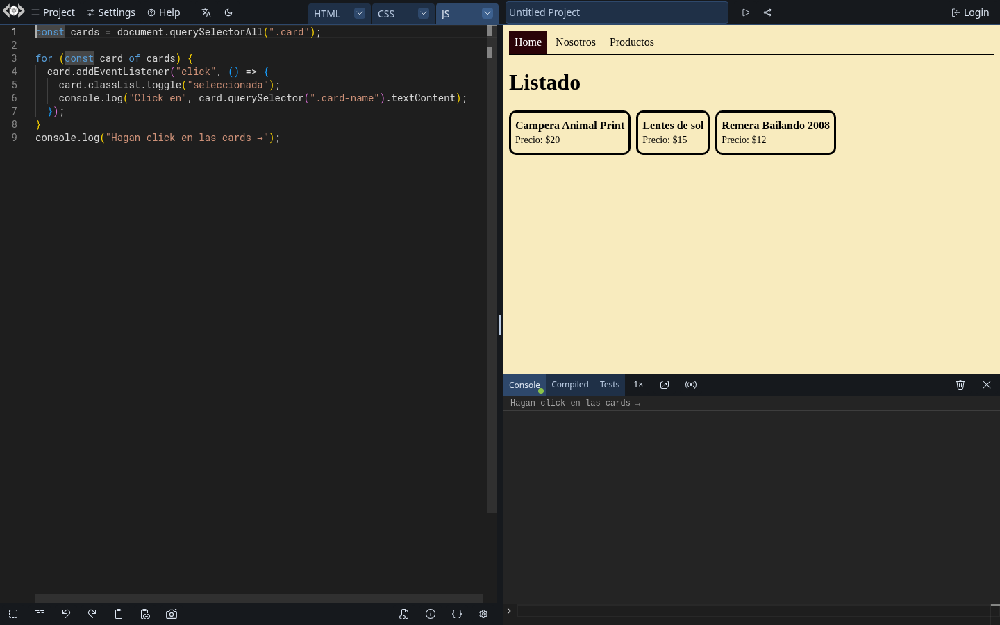
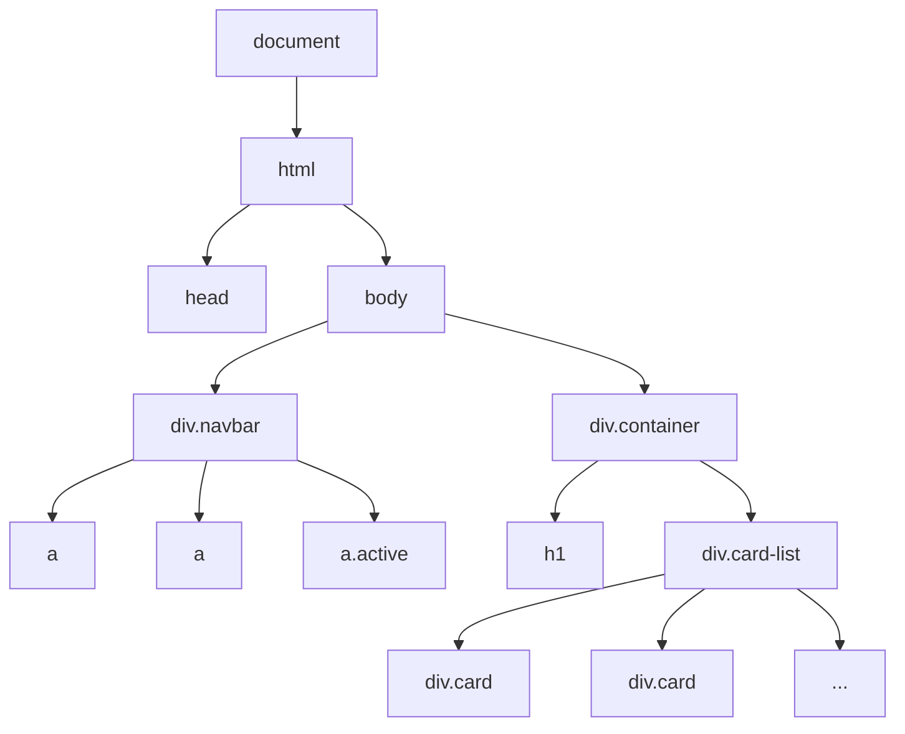
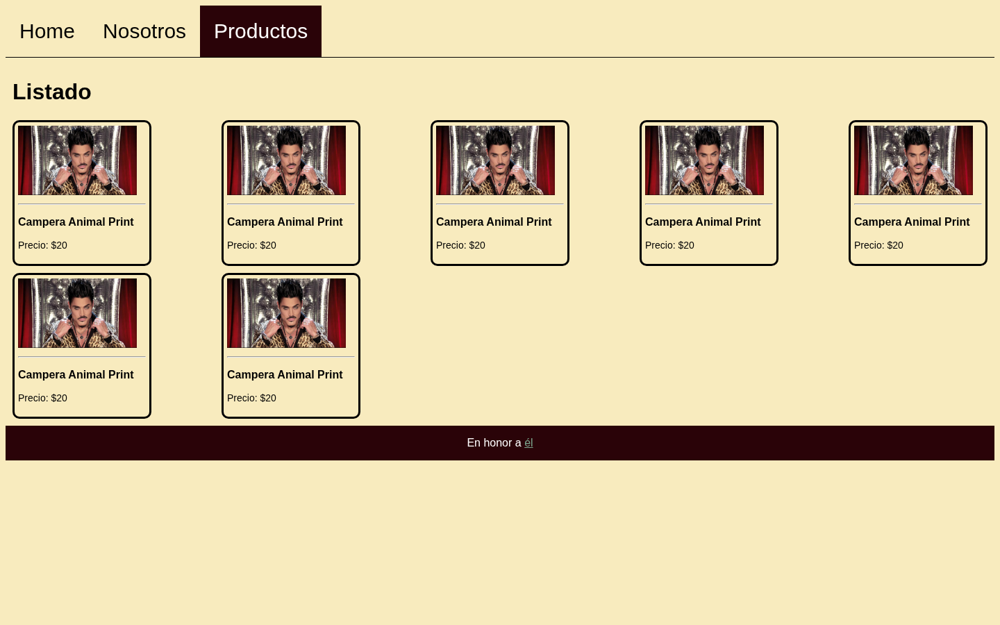
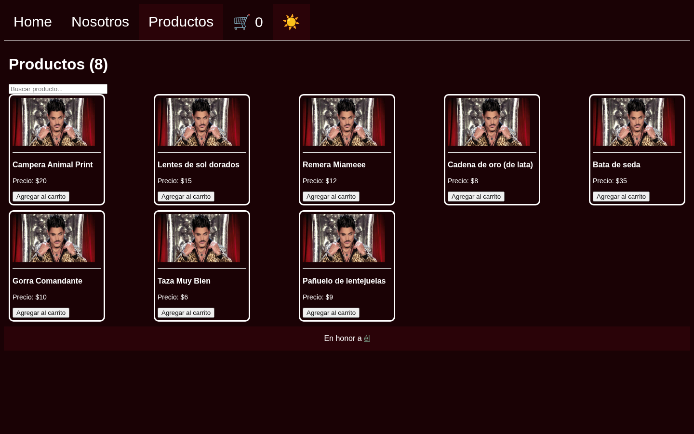

<!-- slide: tipo=portada -->
# JavaScript y el DOM
Del HTML estático a páginas que reaccionan
Clase JavaScript — 2C 2026

---

# ¿Qué es JavaScript?

---

## El tercer lenguaje de la web

- **HTML** dice qué hay en la página, **CSS** dice cómo se ve y **JavaScript** dice qué **hace**
- Es un lenguaje de programación de verdad: variables, condiciones, ciclos, funciones
- Corre en **todos** los navegadores sin instalar nada: por eso es *el* lenguaje de la web {tag:info}

---

## Un poco de historia: 10 días de 1995

- **Brendan Eich** lo crea en **Netscape** en 1995, en unos **10 días**, para darle vida a las páginas del navegador
- Se llamó **Mocha**, después **LiveScript** y al final **JavaScript**
- El último nombre salió de un acuerdo de Netscape con **Sun Microsystems** para aprovechar la fama de Java {tag:note}

---

<!-- slide: tipo=comparacion -->
## Más allá del nombre, Java y JavaScript no se relacionan

### Java
- Sun (James Gosling), 1995
- Se **compila** a bytecode y corre en la **JVM**
- Tipado **estático**: `int precio = 20;`
- Orientado a objetos con **clases**

### JavaScript
- Netscape (Brendan Eich), 1995
- Lo **interpreta** el navegador (hoy con compilación JIT)
- Tipado **dinámico**: `let precio = 20;`
- Objetos basados en **prototipos** (`class` llegó después)

---

## De la guerra de navegadores a ECMAScript

- 1996: Microsoft copia el lenguaje como **JScript** en Internet Explorer, y cada navegador hace lo suyo
- 1997: se estandariza en **Ecma** como **ECMAScript** (ECMA-262). La marca "JavaScript" hoy es de **Oracle**
- 2009: **ES5**, y nace **Node.js**: JS también fuera del navegador
- 2015: **ES6/ES2015**, el gran cambio: `let`/`const`, flechas, `class`, módulos, promesas. Desde ahí sale **una versión por año**
- Hoy: el lenguaje más usado en la encuesta de Stack Overflow 2026 (62% de los respondentes) {tag:info}

---

## ¿Dónde corre?

- En el **navegador**: cada pestaña tiene su motor (V8 en Chrome, SpiderMonkey en Firefox)
- En el **servidor** o la terminal, con **Node.js**: el mismo lenguaje sin página
- Hoy nos quedamos en el navegador: JS que **lee y modifica la página** {tag:tip}

---

## Cargar un script: `<script>`

```html
<head>
  <link rel="stylesheet" href="style.css">
  <script src="app.js" defer></script>
</head>
```

- `src` apunta a un archivo `.js` aparte, igual que el CSS con `<link>`
- `defer`: el script se ejecuta **cuando el HTML ya terminó de cargarse**
- Sin `defer` (en el `<head>`), el script corre antes de que existan los elementos y `querySelector` devuelve `null` {tag:warning}

---

## La consola y las DevTools

- **F12** (o click derecho → Inspeccionar) → pestaña **Console**
- Ahí aparecen los `console.log` y los **errores** (en rojo, con archivo y línea)
- También se puede escribir JS directo y probarlo sobre la página abierta {tag:tip}
- La pestaña **Elements** muestra el DOM **en vivo**: lo que cambie JS se ve ahí

---

<!-- slide: tipo=imagen-texto -->
## Playground: LiveCodes



- Usamos **LiveCodes** (https://livecodes.io): gratis, **sin cuenta** y sin instalar nada
- Editor con **autocompletado**, vista previa de la página y consola
- Cada slide tiene un link que abre su ejemplo **ya cargado**: los de DOM traen una mini copia del listado {tag:tip}
- Alternativa: la consola de las **DevTools** (F12) sobre cualquier página

---

# Sintaxis en 20 minutos

---

## Variables: `let` y `const`

```js
const nombre = "Ricky";   // no se puede reasignar
let visitas = 0;          // sí se puede
visitas = visitas + 1;
nombre = "Fort";          // TypeError
```

- Usen `const` por defecto y `let` solo si el valor cambia
- `let` y `const` viven **dentro de las llaves** `{ }` donde se declaran (scope de bloque)
- `var` es la forma vieja: ignora las llaves y la van a ver en código antiguo. No la usen {tag:note}
- Probalo: [abrir en LiveCodes ↗](https://livecodes.io/?js=%2F%2F%20La%20%C3%BAltima%20l%C3%ADnea%20falla%20a%20prop%C3%B3sito%3A%20miren%20el%20error%20en%20la%20consola.%0Alet%20stock%20%3D%205%3B%0Astock%20%3D%20stock%20-%201%3B%20%20%20%20%20%20%20%20%2F%2F%20let%20se%20puede%20reasignar%0Aconsole.log%28%22Quedan%22%2C%20stock%29%3B%0A%0Aconst%20nombre%20%3D%20%22Campera%20Animal%20Print%22%3B%0Aconsole.log%28nombre%29%3B%0Anombre%20%3D%20%22Otra%20cosa%22%3B%20%20%20%20%2F%2F%20const%20NO%3A%20esto%20tira%20error%0A&active=script&console=open)

---

## Tipos: dinámico y débil

```js
typeof "hola"       // "string"
typeof 20           // "number"  (enteros y decimales son lo mismo)
typeof true         // "boolean"
typeof undefined    // "undefined"
typeof [1, 2]       // "object"  (los arrays son objetos)
typeof null         // "object"  (un error histórico)
```

- **Dinámico**: las variables no tienen tipo, lo tienen los valores (`let x = 42; x = "Hola";` es válido)
- **Débil**: si mezclás tipos, JS convierte solo en vez de dar error (coerción, en la próxima)
- Simples (`number`, `string`, `boolean`), vacíos (`undefined`, `null`) y compuestos (objetos, arrays) {tag:info}
- Probalo: [abrir en LiveCodes ↗](https://livecodes.io/?js=console.log%28typeof%2020%29%3B%20%20%20%20%20%20%20%20%20%20%20%20%20%20%2F%2F%20number%0Aconsole.log%28typeof%20%22Precio%3A%20%2420%22%29%3B%20%20%20%2F%2F%20string%0Aconsole.log%28typeof%20true%29%3B%20%20%20%20%20%20%20%20%20%20%20%20%2F%2F%20boolean%0Aconsole.log%28typeof%20undefined%29%3B%20%20%20%20%20%20%20%2F%2F%20undefined%0Aconsole.log%28typeof%20null%29%3B%20%20%20%20%20%20%20%20%20%20%20%20%2F%2F%20object%20%28%C2%A1un%20error%20hist%C3%B3rico%21%29%0Aconsole.log%28typeof%20%5B1%2C%202%2C%203%5D%29%3B%20%20%20%20%20%20%20%2F%2F%20object%0Aconsole.log%28typeof%20%7B%20nombre%3A%20%22Ricky%22%20%7D%29%3B&active=script&console=open)

---

## Operadores y `===`

```js
2 + 3 * 4        // 14
"20" + 1         // "201"  (concatena)
"20" - 1         // 19     (convierte)
"1" == 1         // true   (convierte antes de comparar)
"1" === 1        // false  (tipo y valor)
```

- Usen **siempre** `===` y `!==` {tag:warning}
- `&&`, `||` y `!` como en cualquier lenguaje
- Probalo: [abrir en LiveCodes ↗](https://livecodes.io/?js=console.log%2820%20%3D%3D%20%2220%22%29%3B%20%20%20%20%2F%2F%20true%3A%20convierte%20el%20string%20a%20n%C3%BAmero%0Aconsole.log%2820%20%3D%3D%3D%20%2220%22%29%3B%20%20%20%2F%2F%20false%3A%20distinto%20tipo%0Aconsole.log%280%20%3D%3D%20false%29%3B%20%20%20%20%20%2F%2F%20true%20%20%F0%9F%98%AC%0Aconsole.log%280%20%3D%3D%3D%20false%29%3B%20%20%20%20%2F%2F%20false%0Aconsole.log%28%225%22%20%2B%203%29%3B%20%20%20%20%20%20%20%20%2F%2F%20%2253%22%3A%20%2B%20con%20un%20string%20concatena%0Aconsole.log%28%225%22%20-%203%29%3B%20%20%20%20%20%20%20%20%2F%2F%202%3A%20-%20convierte%20a%20n%C3%BAmero&active=script&console=open)

---

## Template strings

```js
const producto = "Campera Animal Print";
const precio = 20;
console.log(`${producto} cuesta $${precio}`);
```

- Van con **backticks** (`) y meten expresiones con `${...}`
- Pueden ocupar varias líneas: ideales para armar HTML {tag:tip}
- Probalo: [abrir en LiveCodes ↗](https://livecodes.io/?js=const%20producto%20%3D%20%22Campera%20Animal%20Print%22%3B%0Aconst%20precio%20%3D%2020%3B%0Aconst%20cantidad%20%3D%203%3B%0A%0Aconsole.log%28%22Llev%C3%A1s%20%22%20%2B%20cantidad%20%2B%20%22%20%22%20%2B%20producto%20%2B%20%22%20por%20%24%22%20%2B%20precio%20%2A%20cantidad%29%3B%0Aconsole.log%28%60Llev%C3%A1s%20%24%7Bcantidad%7D%20%24%7Bproducto%7D%20por%20%24%24%7Bprecio%20%2A%20cantidad%7D%60%29%3B&active=script&console=open)

---

## `if` y `for`

```js
if (precio > 15) {
  console.log("caro");
} else {
  console.log("barato");
}

for (let i = 0; i < 3; i++) { console.log(i); }
for (const nombre of ["Home", "Nosotros", "Productos"]) {
  console.log(nombre);
}
```

- `for...of` recorre los elementos de un array (o de una lista del DOM) {tag:tip}
- El `if` acepta cualquier valor: `0`, `""`, `null`, `undefined` y `NaN` cuentan como `false` (*falsy*) {tag:warning}
- Probalo: [if ↗](https://livecodes.io/?js=const%20precio%20%3D%2020%3B%0A%0Aif%20%28precio%20%3E%20100%29%20%7B%0A%20%20console.log%28%22Caro%22%29%3B%0A%7D%20else%20if%20%28precio%20%3E%2015%29%20%7B%0A%20%20console.log%28%22Normal%22%29%3B%0A%7D%20else%20%7B%0A%20%20console.log%28%22Oferta%22%29%3B%0A%7D%0A%0A%2F%2F%20operador%20ternario%3A%20un%20if%20que%20devuelve%20un%20valor%0Aconst%20etiqueta%20%3D%20precio%20%3D%3D%3D%200%20%3F%20%22Gratis%22%20%3A%20%60%24%24%7Bprecio%7D%60%3B%0Aconsole.log%28etiqueta%29%3B&active=script&console=open) · [for ↗](https://livecodes.io/?js=for%20%28let%20i%20%3D%201%3B%20i%20%3C%3D%203%3B%20i%2B%2B%29%20%7B%0A%20%20console.log%28%22Vuelta%22%2C%20i%29%3B%0A%7D%0A%0Aconst%20talles%20%3D%20%5B%22S%22%2C%20%22M%22%2C%20%22L%22%2C%20%22XL%22%5D%3B%0Afor%20%28const%20talle%20of%20talles%29%20%7B%0A%20%20console.log%28%60Talle%20%24%7Btalle%7D%60%29%3B%0A%7D&active=script&console=open)

---

## Funciones y arrow functions

```js
function conIva(precio) {
  return precio * 1.21;
}

const conDescuento = (precio) => precio * 0.9;

console.log(conIva(20), conDescuento(20));
```

- Las dos formas hacen lo mismo. La flecha es más corta y es la que vamos a usar en los eventos
- Una `function` declarada se puede llamar **antes** de la línea donde está (*hoisting*); una guardada en `const`, no
- Una función es un **valor**: se puede guardar en una variable o pasar a otra función {tag:info}
- Probalo: [abrir en LiveCodes ↗](https://livecodes.io/?js=function%20conIva%28precio%29%20%7B%0A%20%20return%20precio%20%2A%201.21%3B%0A%7D%0A%0Aconst%20conDescuento%20%3D%20%28precio%2C%20porcentaje%29%20%3D%3E%20precio%20%2A%20%281%20-%20porcentaje%20%2F%20100%29%3B%0A%0Aconst%20doble%20%3D%20n%20%3D%3E%20n%20%2A%202%3B%20%20%20%2F%2F%20un%20par%C3%A1metro%20y%20una%20expresi%C3%B3n%3A%20sin%20par%C3%A9ntesis%20ni%20return%0A%0Aconsole.log%28conIva%2820%29%29%3B%0Aconsole.log%28conDescuento%2820%2C%2010%29%29%3B%0Aconsole.log%28doble%2821%29%29%3B&active=script&console=open)

---

## Arrays y objetos

```js
const productos = [
  { nombre: "Campera Animal Print", precio: 20 },
  { nombre: "Lentes de sol", precio: 15 },
];
productos.push({ nombre: "Remera", precio: 12 });
console.log(productos.length, productos[0].nombre);
```

- **Array**: lista ordenada que arranca en el índice 0. **Objeto**: pares `clave: valor`
- Es la misma forma que tiene un JSON {tag:info}
- Probalo: [arrays ↗](https://livecodes.io/?js=const%20carrito%20%3D%20%5B%22Campera%22%2C%20%22Lentes%22%5D%3B%0Acarrito.push%28%22Remera%22%29%3B%0Aconsole.log%28carrito%29%3B%0Aconsole.log%28carrito.length%29%3B%0Aconsole.log%28carrito%5B0%5D%29%3B%0Aconsole.log%28carrito.includes%28%22Lentes%22%29%29%3B&active=script&console=open) · [objetos ↗](https://livecodes.io/?js=const%20producto%20%3D%20%7B%0A%20%20nombre%3A%20%22Campera%20Animal%20Print%22%2C%0A%20%20precio%3A%2020%2C%0A%20%20talles%3A%20%5B%22M%22%2C%20%22L%22%5D%2C%0A%7D%3B%0A%0Aconsole.log%28producto.nombre%29%3B%0Aconsole.log%28producto%5B%22precio%22%5D%29%3B%0Aproducto.precio%20%3D%2025%3B%0Aproducto.stock%20%3D%203%3B%20%20%20%2F%2F%20se%20pueden%20agregar%20propiedades%0Aconsole.log%28producto%29%3B&active=script&console=open)

---

## `map` y `filter`

```js
const precios = productos.map(p => p.precio);        // [20, 15, 12]
const baratos = productos.filter(p => p.precio < 18); // 2 productos
const total = precios.reduce((a, b) => a + b, 0);    // 47
```

- `map` **transforma** cada elemento y `filter` **se queda** con los que cumplen la condición
- Ninguno modifica el array original: los dos devuelven uno nuevo {tag:tip}
- Probalo: [abrir en LiveCodes ↗](https://livecodes.io/?js=const%20productos%20%3D%20%5B%0A%20%20%7B%20nombre%3A%20%22Campera%20Animal%20Print%22%2C%20precio%3A%2020%20%7D%2C%0A%20%20%7B%20nombre%3A%20%22Lentes%20de%20sol%22%2C%20precio%3A%2015%20%7D%2C%0A%20%20%7B%20nombre%3A%20%22Remera%20Bailando%202008%22%2C%20precio%3A%2012%20%7D%2C%0A%5D%3B%0A%0Aconst%20nombres%20%3D%20productos.map%28p%20%3D%3E%20p.nombre%29%3B%0Aconsole.log%28nombres%29%3B%0A%0Aconst%20baratos%20%3D%20productos.filter%28p%20%3D%3E%20p.precio%20%3C%2016%29%3B%0Aconsole.log%28baratos%29%3B%0A%0Aconst%20total%20%3D%20productos.reduce%28%28suma%2C%20p%29%20%3D%3E%20suma%20%2B%20p.precio%2C%200%29%3B%0Aconsole.log%28%22Total%3A%22%2C%20total%29%3B&active=script&console=open)

---

## Imperativo vs declarativo

```js
// Imperativo: el CÓMO, paso a paso
const pares = [];
for (let i = 0; i < numeros.length; i++) {
  if (numeros[i] % 2 === 0) pares.push(numeros[i] * 2);
}

// Declarativo: el QUÉ
const resultado = numeros.filter(n => n % 2 === 0).map(n => n * 2);
```

- Mismo resultado: duplicar los pares de `[1, 2, 3, 4, 5, 6]` → `[4, 8, 12]`
- El declarativo se lee como la consigna y **no modifica** el array original {tag:tip}

---

# El DOM

---

## La página es un árbol



- El navegador convierte el HTML en objetos: el **DOM** (Document Object Model). JS los ve en `document`

---

## Buscar elementos: `querySelector`

```js
const titulo = document.querySelector("h1");            // el primero
const cards = document.querySelectorAll(".card");       // todos (NodeList)
const activo = document.querySelector(".navbar a.active");
console.log(cards.length);
```

- Usan **los mismos selectores que CSS** {tag:tip}
- Si no encuentra nada, `querySelector` devuelve `null`
- Probalo: [abrir en LiveCodes ↗](https://livecodes.io/?html=%3Cdiv%20class%3D%22navbar%22%3E%0A%20%20%3Ca%20href%3D%22%23%22%20class%3D%22active%22%3EHome%3C%2Fa%3E%0A%20%20%3Ca%20href%3D%22%23%22%3ENosotros%3C%2Fa%3E%0A%20%20%3Ca%20href%3D%22%23%22%3EProductos%3C%2Fa%3E%0A%3C%2Fdiv%3E%0A%3Cdiv%20class%3D%22container%22%3E%0A%20%20%3Ch1%3EListado%3C%2Fh1%3E%0A%20%20%3Cdiv%20class%3D%22card-list%22%3E%0A%20%20%20%20%3Cdiv%20class%3D%22card%22%3E%3Cp%20class%3D%22card-name%22%3ECampera%20Animal%20Print%3C%2Fp%3E%3Cp%20class%3D%22card-price%22%3EPrecio%3A%20%2420%3C%2Fp%3E%3C%2Fdiv%3E%0A%20%20%20%20%3Cdiv%20class%3D%22card%22%3E%3Cp%20class%3D%22card-name%22%3ELentes%20de%20sol%3C%2Fp%3E%3Cp%20class%3D%22card-price%22%3EPrecio%3A%20%2415%3C%2Fp%3E%3C%2Fdiv%3E%0A%20%20%20%20%3Cdiv%20class%3D%22card%22%3E%3Cp%20class%3D%22card-name%22%3ERemera%20Bailando%202008%3C%2Fp%3E%3Cp%20class%3D%22card-price%22%3EPrecio%3A%20%2412%3C%2Fp%3E%3C%2Fdiv%3E%0A%20%20%3C%2Fdiv%3E%0A%3C%2Fdiv%3E&css=.navbar%7Bdisplay%3Aflex%3Bgap%3A4px%3Bborder-bottom%3A1px%20solid%7D.navbar%20a%7Bpadding%3A8px%3Bcolor%3Ablack%3Btext-decoration%3Anone%7D%0A%20%20.navbar%20a.active%7Bbackground%3A%232a0308%3Bcolor%3Awhite%7D%0A%20%20body%7Bbackground%3A%23f8ebbe%7D.card-list%7Bdisplay%3Aflex%3Bgap%3A8px%7D.card%7Bborder%3A3px%20solid%3Bborder-radius%3A10px%3Bpadding%3A6px%7D%0A%20%20.card-name%7Bfont-weight%3Abold%3Bmargin%3A4px%200%7D.card-price%7Bfont-size%3A14px%3Bmargin%3A4px%200%7D%0A%20%20.seleccionada%7Bbackground%3A%232a0308%3Bcolor%3Awhite%7D&js=const%20titulo%20%3D%20document.querySelector%28%22h1%22%29%3B%0Aconsole.log%28titulo.textContent%29%3B%0A%0Aconst%20cards%20%3D%20document.querySelectorAll%28%22.card%22%29%3B%0Aconsole.log%28cards.length%2C%20%22productos%22%29%3B%0A%0Aconst%20primera%20%3D%20document.querySelector%28%22.card%20.card-name%22%29%3B%0Aconsole.log%28primera.textContent%29%3B&active=script&console=open)

---

## Cambiar contenido: `textContent` e `innerHTML`

```js
titulo.textContent = "Productos";
const card = document.querySelector(".card");
card.querySelector(".card-price").textContent = "Precio: $25";
card.innerHTML = "<p class='card-name'>Agotado</p>";
```

- `textContent` cambia **texto** y `innerHTML` interpreta **HTML**
- Nunca metan en `innerHTML` texto que escribió un usuario: abre la puerta a inyectar código (XSS) {tag:danger}
- Probalo: [abrir en LiveCodes ↗](https://livecodes.io/?html=%3Cdiv%20class%3D%22navbar%22%3E%0A%20%20%3Ca%20href%3D%22%23%22%20class%3D%22active%22%3EHome%3C%2Fa%3E%0A%20%20%3Ca%20href%3D%22%23%22%3ENosotros%3C%2Fa%3E%0A%20%20%3Ca%20href%3D%22%23%22%3EProductos%3C%2Fa%3E%0A%3C%2Fdiv%3E%0A%3Cdiv%20class%3D%22container%22%3E%0A%20%20%3Ch1%3EListado%3C%2Fh1%3E%0A%20%20%3Cdiv%20class%3D%22card-list%22%3E%0A%20%20%20%20%3Cdiv%20class%3D%22card%22%3E%3Cp%20class%3D%22card-name%22%3ECampera%20Animal%20Print%3C%2Fp%3E%3Cp%20class%3D%22card-price%22%3EPrecio%3A%20%2420%3C%2Fp%3E%3C%2Fdiv%3E%0A%20%20%20%20%3Cdiv%20class%3D%22card%22%3E%3Cp%20class%3D%22card-name%22%3ELentes%20de%20sol%3C%2Fp%3E%3Cp%20class%3D%22card-price%22%3EPrecio%3A%20%2415%3C%2Fp%3E%3C%2Fdiv%3E%0A%20%20%20%20%3Cdiv%20class%3D%22card%22%3E%3Cp%20class%3D%22card-name%22%3ERemera%20Bailando%202008%3C%2Fp%3E%3Cp%20class%3D%22card-price%22%3EPrecio%3A%20%2412%3C%2Fp%3E%3C%2Fdiv%3E%0A%20%20%3C%2Fdiv%3E%0A%3C%2Fdiv%3E&css=.navbar%7Bdisplay%3Aflex%3Bgap%3A4px%3Bborder-bottom%3A1px%20solid%7D.navbar%20a%7Bpadding%3A8px%3Bcolor%3Ablack%3Btext-decoration%3Anone%7D%0A%20%20.navbar%20a.active%7Bbackground%3A%232a0308%3Bcolor%3Awhite%7D%0A%20%20body%7Bbackground%3A%23f8ebbe%7D.card-list%7Bdisplay%3Aflex%3Bgap%3A8px%7D.card%7Bborder%3A3px%20solid%3Bborder-radius%3A10px%3Bpadding%3A6px%7D%0A%20%20.card-name%7Bfont-weight%3Abold%3Bmargin%3A4px%200%7D.card-price%7Bfont-size%3A14px%3Bmargin%3A4px%200%7D%0A%20%20.seleccionada%7Bbackground%3A%232a0308%3Bcolor%3Awhite%7D&js=const%20titulo%20%3D%20document.querySelector%28%22h1%22%29%3B%0Atitulo.textContent%20%3D%20%22Productos%22%3B%0Atitulo.style.color%20%3D%20%22%23924f1b%22%3B%0A%0Afor%20%28const%20precio%20of%20document.querySelectorAll%28%22.card-price%22%29%29%20%7B%0A%20%20precio.textContent%20%2B%3D%20%22%20USD%22%3B%0A%7D&active=script&console=open)

---

## Clases y estilos

```js
card.classList.add("seleccionada");
card.classList.remove("seleccionada");
card.classList.toggle("seleccionada");   // pone o saca
card.classList.contains("seleccionada"); // true / false
card.style.display = "none";             // estilo inline
```

- Prefieran `classList` y dejen el estilo en el CSS. `style` sirve para casos puntuales {tag:tip}
- Probalo: [abrir en LiveCodes ↗](https://livecodes.io/?html=%3Cdiv%20class%3D%22navbar%22%3E%0A%20%20%3Ca%20href%3D%22%23%22%20class%3D%22active%22%3EHome%3C%2Fa%3E%0A%20%20%3Ca%20href%3D%22%23%22%3ENosotros%3C%2Fa%3E%0A%20%20%3Ca%20href%3D%22%23%22%3EProductos%3C%2Fa%3E%0A%3C%2Fdiv%3E%0A%3Cdiv%20class%3D%22container%22%3E%0A%20%20%3Ch1%3EListado%3C%2Fh1%3E%0A%20%20%3Cdiv%20class%3D%22card-list%22%3E%0A%20%20%20%20%3Cdiv%20class%3D%22card%22%3E%3Cp%20class%3D%22card-name%22%3ECampera%20Animal%20Print%3C%2Fp%3E%3Cp%20class%3D%22card-price%22%3EPrecio%3A%20%2420%3C%2Fp%3E%3C%2Fdiv%3E%0A%20%20%20%20%3Cdiv%20class%3D%22card%22%3E%3Cp%20class%3D%22card-name%22%3ELentes%20de%20sol%3C%2Fp%3E%3Cp%20class%3D%22card-price%22%3EPrecio%3A%20%2415%3C%2Fp%3E%3C%2Fdiv%3E%0A%20%20%20%20%3Cdiv%20class%3D%22card%22%3E%3Cp%20class%3D%22card-name%22%3ERemera%20Bailando%202008%3C%2Fp%3E%3Cp%20class%3D%22card-price%22%3EPrecio%3A%20%2412%3C%2Fp%3E%3C%2Fdiv%3E%0A%20%20%3C%2Fdiv%3E%0A%3C%2Fdiv%3E&css=.navbar%7Bdisplay%3Aflex%3Bgap%3A4px%3Bborder-bottom%3A1px%20solid%7D.navbar%20a%7Bpadding%3A8px%3Bcolor%3Ablack%3Btext-decoration%3Anone%7D%0A%20%20.navbar%20a.active%7Bbackground%3A%232a0308%3Bcolor%3Awhite%7D%0A%20%20body%7Bbackground%3A%23f8ebbe%7D.card-list%7Bdisplay%3Aflex%3Bgap%3A8px%7D.card%7Bborder%3A3px%20solid%3Bborder-radius%3A10px%3Bpadding%3A6px%7D%0A%20%20.card-name%7Bfont-weight%3Abold%3Bmargin%3A4px%200%7D.card-price%7Bfont-size%3A14px%3Bmargin%3A4px%200%7D%0A%20%20.seleccionada%7Bbackground%3A%232a0308%3Bcolor%3Awhite%7D&js=const%20card%20%3D%20document.querySelector%28%22.card%22%29%3B%0Acard.classList.add%28%22seleccionada%22%29%3B%0Aconsole.log%28card.classList.contains%28%22seleccionada%22%29%29%3B%0A%0A%2F%2F%20toggle%3A%20si%20la%20tiene%20la%20saca%2C%20si%20no%20la%20pone%0Adocument.querySelectorAll%28%22.card%22%29%5B2%5D.classList.toggle%28%22seleccionada%22%29%3B&active=script&console=open)

---

## Crear elementos

```js
const card = document.createElement("div");
card.className = "card";
card.innerHTML = `<p class="card-name">Lentes de sol</p>`;
document.querySelector(".card-list").append(card);
```

- `createElement` crea el nodo y `append` lo cuelga del árbol: **recién ahí se ve**
- También existen `prepend`, `before`, `after` y `remove`
- Probalo: [abrir en LiveCodes ↗](https://livecodes.io/?html=%3Cdiv%20class%3D%22navbar%22%3E%0A%20%20%3Ca%20href%3D%22%23%22%20class%3D%22active%22%3EHome%3C%2Fa%3E%0A%20%20%3Ca%20href%3D%22%23%22%3ENosotros%3C%2Fa%3E%0A%20%20%3Ca%20href%3D%22%23%22%3EProductos%3C%2Fa%3E%0A%3C%2Fdiv%3E%0A%3Cdiv%20class%3D%22container%22%3E%0A%20%20%3Ch1%3EListado%3C%2Fh1%3E%0A%20%20%3Cdiv%20class%3D%22card-list%22%3E%0A%20%20%20%20%3Cdiv%20class%3D%22card%22%3E%3Cp%20class%3D%22card-name%22%3ECampera%20Animal%20Print%3C%2Fp%3E%3Cp%20class%3D%22card-price%22%3EPrecio%3A%20%2420%3C%2Fp%3E%3C%2Fdiv%3E%0A%20%20%20%20%3Cdiv%20class%3D%22card%22%3E%3Cp%20class%3D%22card-name%22%3ELentes%20de%20sol%3C%2Fp%3E%3Cp%20class%3D%22card-price%22%3EPrecio%3A%20%2415%3C%2Fp%3E%3C%2Fdiv%3E%0A%20%20%20%20%3Cdiv%20class%3D%22card%22%3E%3Cp%20class%3D%22card-name%22%3ERemera%20Bailando%202008%3C%2Fp%3E%3Cp%20class%3D%22card-price%22%3EPrecio%3A%20%2412%3C%2Fp%3E%3C%2Fdiv%3E%0A%20%20%3C%2Fdiv%3E%0A%3C%2Fdiv%3E&css=.navbar%7Bdisplay%3Aflex%3Bgap%3A4px%3Bborder-bottom%3A1px%20solid%7D.navbar%20a%7Bpadding%3A8px%3Bcolor%3Ablack%3Btext-decoration%3Anone%7D%0A%20%20.navbar%20a.active%7Bbackground%3A%232a0308%3Bcolor%3Awhite%7D%0A%20%20body%7Bbackground%3A%23f8ebbe%7D.card-list%7Bdisplay%3Aflex%3Bgap%3A8px%7D.card%7Bborder%3A3px%20solid%3Bborder-radius%3A10px%3Bpadding%3A6px%7D%0A%20%20.card-name%7Bfont-weight%3Abold%3Bmargin%3A4px%200%7D.card-price%7Bfont-size%3A14px%3Bmargin%3A4px%200%7D%0A%20%20.seleccionada%7Bbackground%3A%232a0308%3Bcolor%3Awhite%7D&js=const%20card%20%3D%20document.createElement%28%22div%22%29%3B%0Acard.className%20%3D%20%22card%22%3B%0A%0Aconst%20nombre%20%3D%20document.createElement%28%22p%22%29%3B%0Anombre.className%20%3D%20%22card-name%22%3B%0Anombre.textContent%20%3D%20%22Gorra%20Ricky%20Fort%22%3B%0A%0Acard.append%28nombre%29%3B%0Adocument.querySelector%28%22.card-list%22%29.append%28card%29%3B&active=script&console=open)

---

## Eventos: `addEventListener`

```js
const card = document.querySelector(".card");
card.addEventListener("click", () => {
  card.classList.toggle("seleccionada");
});
```

- "Cuando pase **esto**, ejecutá **esta función**"
- La función se ejecuta **cada vez** que ocurre el evento, no cuando se escribe
- Probalo: [abrir en LiveCodes ↗](https://livecodes.io/?html=%3Cdiv%20class%3D%22navbar%22%3E%0A%20%20%3Ca%20href%3D%22%23%22%20class%3D%22active%22%3EHome%3C%2Fa%3E%0A%20%20%3Ca%20href%3D%22%23%22%3ENosotros%3C%2Fa%3E%0A%20%20%3Ca%20href%3D%22%23%22%3EProductos%3C%2Fa%3E%0A%3C%2Fdiv%3E%0A%3Cdiv%20class%3D%22container%22%3E%0A%20%20%3Ch1%3EListado%3C%2Fh1%3E%0A%20%20%3Cdiv%20class%3D%22card-list%22%3E%0A%20%20%20%20%3Cdiv%20class%3D%22card%22%3E%3Cp%20class%3D%22card-name%22%3ECampera%20Animal%20Print%3C%2Fp%3E%3Cp%20class%3D%22card-price%22%3EPrecio%3A%20%2420%3C%2Fp%3E%3C%2Fdiv%3E%0A%20%20%20%20%3Cdiv%20class%3D%22card%22%3E%3Cp%20class%3D%22card-name%22%3ELentes%20de%20sol%3C%2Fp%3E%3Cp%20class%3D%22card-price%22%3EPrecio%3A%20%2415%3C%2Fp%3E%3C%2Fdiv%3E%0A%20%20%20%20%3Cdiv%20class%3D%22card%22%3E%3Cp%20class%3D%22card-name%22%3ERemera%20Bailando%202008%3C%2Fp%3E%3Cp%20class%3D%22card-price%22%3EPrecio%3A%20%2412%3C%2Fp%3E%3C%2Fdiv%3E%0A%20%20%3C%2Fdiv%3E%0A%3C%2Fdiv%3E&css=.navbar%7Bdisplay%3Aflex%3Bgap%3A4px%3Bborder-bottom%3A1px%20solid%7D.navbar%20a%7Bpadding%3A8px%3Bcolor%3Ablack%3Btext-decoration%3Anone%7D%0A%20%20.navbar%20a.active%7Bbackground%3A%232a0308%3Bcolor%3Awhite%7D%0A%20%20body%7Bbackground%3A%23f8ebbe%7D.card-list%7Bdisplay%3Aflex%3Bgap%3A8px%7D.card%7Bborder%3A3px%20solid%3Bborder-radius%3A10px%3Bpadding%3A6px%7D%0A%20%20.card-name%7Bfont-weight%3Abold%3Bmargin%3A4px%200%7D.card-price%7Bfont-size%3A14px%3Bmargin%3A4px%200%7D%0A%20%20.seleccionada%7Bbackground%3A%232a0308%3Bcolor%3Awhite%7D&js=const%20cards%20%3D%20document.querySelectorAll%28%22.card%22%29%3B%0A%0Afor%20%28const%20card%20of%20cards%29%20%7B%0A%20%20card.addEventListener%28%22click%22%2C%20%28%29%20%3D%3E%20%7B%0A%20%20%20%20card.classList.toggle%28%22seleccionada%22%29%3B%0A%20%20%20%20console.log%28%22Click%20en%22%2C%20card.querySelector%28%22.card-name%22%29.textContent%29%3B%0A%20%20%7D%29%3B%0A%7D%0Aconsole.log%28%22Hagan%20click%20en%20las%20cards%20%E2%86%92%22%29%3B&active=script&console=open)

---

## `input` y `submit`

```js
buscador.addEventListener("input", () => {
  console.log(buscador.value);       // en cada tecla
});

formulario.addEventListener("submit", (evento) => {
  evento.preventDefault();           // que no recargue la página
  console.log("enviado");
});
```

- `evento.preventDefault()` cancela lo que el navegador haría solo (recargar, seguir un link) {tag:warning}
- Probalo: [input ↗](https://livecodes.io/?html=%3Clabel%3EBuscar%3A%20%3Cinput%20id%3D%22buscador%22%20placeholder%3D%22escrib%C3%AD%20algo%22%3E%3C%2Flabel%3E%0A%3Cp%20id%3D%22eco%22%3E%3C%2Fp%3E&js=const%20buscador%20%3D%20document.querySelector%28%22%23buscador%22%29%3B%0Aconst%20eco%20%3D%20document.querySelector%28%22%23eco%22%29%3B%0A%0Abuscador.addEventListener%28%22input%22%2C%20%28%29%20%3D%3E%20%7B%0A%20%20eco.textContent%20%3D%20%60Est%C3%A1s%20buscando%3A%20%24%7Bbuscador.value%7D%60%3B%0A%7D%29%3B&active=script&console=open) · [submit ↗](https://livecodes.io/?html=%3Cform%20id%3D%22suscripcion%22%3E%0A%20%20%3Cinput%20name%3D%22email%22%20type%3D%22email%22%20placeholder%3D%22tu%40mail.com%22%20required%3E%0A%20%20%3Cbutton%3ESuscribirme%3C%2Fbutton%3E%0A%3C%2Fform%3E&js=const%20form%20%3D%20document.querySelector%28%22%23suscripcion%22%29%3B%0A%0Aform.addEventListener%28%22submit%22%2C%20%28evento%29%20%3D%3E%20%7B%0A%20%20evento.preventDefault%28%29%3B%20%20%20%2F%2F%20sin%20esto%2C%20la%20p%C3%A1gina%20se%20recarga%0A%20%20const%20email%20%3D%20form.email.value%3B%0A%20%20console.log%28%22Suscripto%3A%22%2C%20email%29%3B%0A%20%20form.reset%28%29%3B%0A%7D%29%3B&active=script&console=open)

---

# Asincronismo (adelanto)

---

## No todo pasa en orden

```js
console.log("1");
setTimeout(() => console.log("2"), 1000);
console.log("3");          // imprime 1, 3, 2
```

- Hay cosas que **tardan** (un timer, un pedido a un servidor), y JS **no se queda esperando**
- Les deja una función para "cuando termine" y sigue con lo demás
- Probalo: [abrir en LiveCodes ↗](https://livecodes.io/?js=console.log%28%221.%20Antes%22%29%3B%0A%0AsetTimeout%28%28%29%20%3D%3E%20%7B%0A%20%20console.log%28%223.%20Un%20segundo%20despu%C3%A9s%22%29%3B%0A%7D%2C%201000%29%3B%0A%0Aconsole.log%28%222.%20Despu%C3%A9s%20%28%C2%A1pero%20se%20imprime%20antes%20que%20el%203%21%29%22%29%3B&active=script&console=open)

---

## `fetch`: pedirle datos a una API

```js
async function dolarBlue() {
  const respuesta = await fetch("https://dolarapi.com/v1/dolares/blue");
  const dolar = await respuesta.json();
  console.log(`US$20 = $${20 * dolar.venta}`);
}
dolarBlue();
```

- `await` espera la respuesta **sin congelar** la página
- Lo vemos a fondo el **martes**: JS en el navegador y consumo de una API pública {tag:info}
- Probalo: [abrir en LiveCodes ↗](https://livecodes.io/?js=%2F%2F%20Necesita%20internet%3A%20le%20pide%20la%20cotizaci%C3%B3n%20a%20dolarapi.com.%0Aasync%20function%20precioEnPesos%28dolares%29%20%7B%0A%20%20const%20respuesta%20%3D%20await%20fetch%28%22https%3A%2F%2Fdolarapi.com%2Fv1%2Fdolares%2Fblue%22%29%3B%0A%20%20const%20dolar%20%3D%20await%20respuesta.json%28%29%3B%0A%20%20console.log%28%22D%C3%B3lar%20blue%2C%20venta%3A%22%2C%20dolar.venta%29%3B%0A%20%20return%20dolares%20%2A%20dolar.venta%3B%0A%7D%0A%0Aconsole.log%28%22Pidiendo%20la%20cotizaci%C3%B3n...%22%29%3B%0AprecioEnPesos%2820%29.then%28pesos%20%3D%3E%20%7B%0A%20%20console.log%28%60La%20campera%20de%20%2420%20USD%20sale%20%24%24%7Bpesos%7D%20pesos%60%29%3B%0A%7D%29%3B&active=script&console=open)

---

# Práctica: Ricky Fort Merch

---

<!-- slide: tipo=imagen-texto -->
## La página de Manu



- `listado.html` + `style.css` del repo **ricky-fort-merch**
- `.navbar` con 3 links y `.card-list` con 7 `.card` (todas iguales)
- Cada card tiene `.card-img`, `.card-name` y `.card-price`
- Hoy la hacemos **reaccionar** sin tocar el HTML

---

## Preparación

```html
<link rel="stylesheet" href="style.css">
<script src="app.js" defer></script>
```

- Hagan una **copia propia** de `listado.html` y `style.css` y creen un `app.js` vacío al lado
- Agreguen el `<script>` en el `<head>` y abran la página con las DevTools abiertas
- Cada ejercicio **se suma** al anterior en el mismo `app.js` {tag:tip}

---

## CSS que vamos a necesitar

```css
.card.seleccionada { background-color: var(--color-terciario); color: white; }
body.oscuro { --color-primary: #1a0205; color: white; }
body.oscuro .navbar a { color: white; }
```

- Al final de `style.css`. Usan las variables que ya define la página en `:root`
- JS **solo pone y saca clases**. Cómo se ven lo sigue decidiendo el CSS {tag:info}

---

# Ejercicios

---

## Ejercicios 1 a 3

1. **Consola**: con `querySelectorAll`, imprimí cuántas cards hay y el nombre de cada una
2. **Datos en un array**: armá un array `productos` con 8 objetos `{ nombre, precio }` (inventen) y generá las cards con `createElement`. La foto: reusen el `src` de la primera `.card-img`
3. **Título**: que el `h1` diga `Productos (8)`, contando las cards del DOM

- Mantengan las clases `card`, `card-img`, `card-name` y `card-price` para que el CSS siga funcionando {tag:tip}

---

## Ejercicios 4 a 7

4. **Seleccionar**: click en una card → `toggle` de la clase `seleccionada`
5. **Carrito**: agregá `🛒 0` a la navbar y un botón "Agregar al carrito" en cada card que sume 1
6. **Buscador**: un `<input>` antes de `.card-list` que oculte las cards cuyo nombre no contiene lo escrito (sin importar mayúsculas)
7. **Modo oscuro**: un link 🌙 en la navbar que haga `toggle` de `oscuro` en el `body`

- En el 5, el click del botón también llega a la card: busquen `stopPropagation` {tag:warning}

---

## Desafío y bonus

8. **Desafío**: debajo de la lista, mostrá `Seleccionaste N productos: $X` sumando los precios de las cards seleccionadas (`filter` + `reduce`)
9. **Bonus asincrónico**: con `fetch` a https://dolarapi.com/v1/dolares/blue, mostrá cada precio también en pesos: `Precio: US$20 (≈ $31.300)`

- El 9 es adelanto del martes: si no sale, no pasa nada {tag:note}

---

# Soluciones

---

## Solución 1

```js
const cards = document.querySelectorAll(".card");
console.log(`Hay ${cards.length} productos`);
for (const card of cards) {
  console.log(card.querySelector(".card-name").textContent);
}
```
```
Hay 7 productos
Campera Animal Print   (x7)
```

---

## Solución 2: los datos

```js
const IMG = document.querySelector(".card-img").src;  // la única foto 😅

const productos = [
  { nombre: "Campera Animal Print", precio: 20 },
  { nombre: "Lentes de sol dorados", precio: 15 },
  { nombre: "Remera Miameee", precio: 12 },
  { nombre: "Cadena de oro (de lata)", precio: 8 },
  { nombre: "Bata de seda", precio: 35 },
  { nombre: "Gorra Comandante", precio: 10 },
  { nombre: "Taza Muy Bien", precio: 6 },
  { nombre: "Pañuelo de lentejuelas", precio: 9 },
];
```

---

## Solución 2: el render

```js
const lista = document.querySelector(".card-list");
lista.innerHTML = "";   // chau a las 7 camperas repetidas

for (const producto of productos) {
  const card = document.createElement("div");
  card.className = "card";
  card.innerHTML = `
    
    <hr>
    <p class="card-name">${producto.nombre}</p>
    <p class="card-price">Precio: $${producto.precio}</p>`;
  lista.append(card);
}
```

---

## Soluciones 3 y 4

```js
const titulo = document.querySelector(".container h1");
titulo.textContent = `Productos (${document.querySelectorAll(".card").length})`;

for (const card of document.querySelectorAll(".card")) {
  card.addEventListener("click", () => {
    card.classList.toggle("seleccionada");
  });
}
```

- Los listeners van **después** del render: si se regeneran las cards, se pierden {tag:warning}

---

## Solución 5

```js
const contador = document.createElement("a");
contador.href = "#";
contador.textContent = "🛒 0";
document.querySelector(".navbar").append(contador);
let enCarrito = 0;
for (const card of document.querySelectorAll(".card")) {
  const boton = document.createElement("button");
  boton.textContent = "Agregar al carrito";
  boton.addEventListener("click", (evento) => {
    evento.stopPropagation();   // que no seleccione la card
    enCarrito++;
    contador.textContent = `🛒 ${enCarrito}`;
  });
  card.append(boton);
}
```

---

## Solución 6

```js
const buscador = document.createElement("input");
buscador.placeholder = "Buscar producto...";
document.querySelector(".card-list").before(buscador);

buscador.addEventListener("input", () => {
  const texto = buscador.value.toLowerCase();
  for (const card of document.querySelectorAll(".card")) {
    const nombre = card.querySelector(".card-name").textContent.toLowerCase();
    card.style.display = nombre.includes(texto) ? "" : "none";
  }
});
```

---

## Solución 7

```js
const botonModo = document.createElement("a");
botonModo.href = "#";
botonModo.textContent = "🌙";
document.querySelector(".navbar").append(botonModo);

botonModo.addEventListener("click", (evento) => {
  evento.preventDefault();   // es un <a>: que no navegue
  document.body.classList.toggle("oscuro");
  botonModo.textContent = document.body.classList.contains("oscuro") ? "☀️" : "🌙";
});
```

---

## Solución 8 (desafío)

```js
const total = document.createElement("p");
document.querySelector(".card-list").after(total);

function actualizarTotal() {
  const nombres = [...document.querySelectorAll(".card.seleccionada .card-name")]
    .map(p => p.textContent);
  const suma = productos
    .filter(p => nombres.includes(p.nombre))
    .reduce((acumulado, p) => acumulado + p.precio, 0);
  total.textContent = `Seleccionaste ${nombres.length} productos: $${suma}`;
}
document.querySelector(".card-list").addEventListener("click", actualizarTotal);
actualizarTotal();
```

---

## Solución 9 (bonus)

```js
async function mostrarEnPesos() {
  const respuesta = await fetch("https://dolarapi.com/v1/dolares/blue");
  const dolar = await respuesta.json();
  const precios = document.querySelectorAll(".card-price");
  productos.forEach((producto, i) => {
    const pesos = Math.round(producto.precio * dolar.venta);
    precios[i].textContent =
      `Precio: US$${producto.precio} (≈ $${pesos.toLocaleString("es-AR")})`;
  });
}
mostrarEnPesos();
```

---

<!-- slide: tipo=imagen-texto -->
## Así queda



- 8 productos generados desde un array
- Título con contador, cards seleccionables y carrito
- Buscador y modo oscuro
- **Sin tocar una línea** del HTML original

---

# Cierre

---

## Resumen

- JS se carga con `<script src defer>` y se depura en la **consola**
- `const`/`let`, `===`, template strings, funciones flecha, arrays de objetos, `map`/`filter`
- DOM: `querySelector` → cambiar (`textContent`, `classList`) → crear (`createElement` + `append`)
- Eventos: `addEventListener` con `click`, `input` y `submit`
- **Martes 27/10**: JS en el navegador y consumo de una API pública. Traigan el ejercicio 9 andando {tag:info}

---

<!-- slide: tipo=bibliografia -->
## Bibliografía

1. MDN — JavaScript first steps (https://developer.mozilla.org/es/docs/Learn/JavaScript/First_steps)
2. MDN — Introducción al DOM (https://developer.mozilla.org/es/docs/Web/API/Document_Object_Model/Introduction)
3. MDN — Introducción a los eventos (https://developer.mozilla.org/es/docs/Learn/JavaScript/Building_blocks/Events)
4. MDN — Array.prototype.map (https://developer.mozilla.org/es/docs/Web/JavaScript/Reference/Global_Objects/Array/map)
5. MDN — Usando Fetch (https://developer.mozilla.org/es/docs/Web/API/Fetch_API/Using_Fetch)
6. javascript.info — The Modern JavaScript Tutorial (https://es.javascript.info/)

---

<!-- slide: tipo=cierre -->
# ¡Gracias!

Para practicar: https://livecodes.io/
